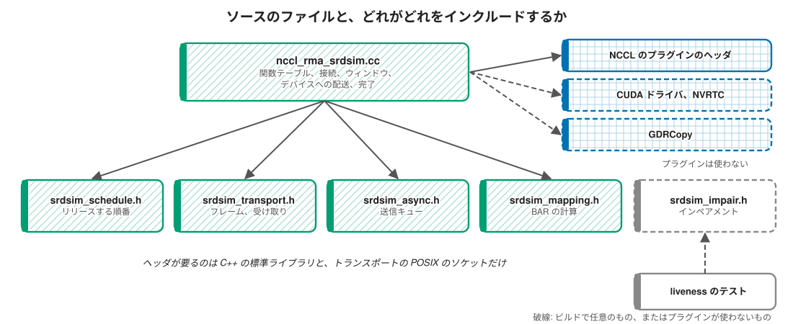
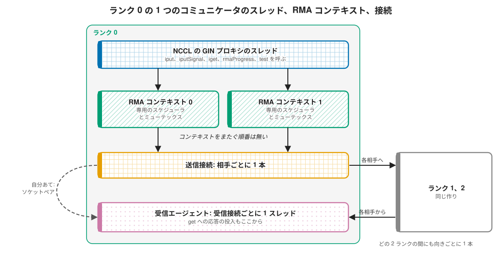
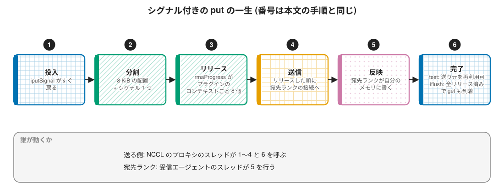
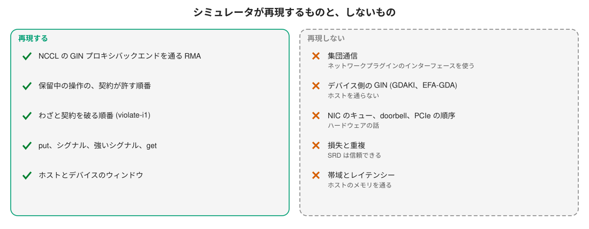

# アーキテクチャ

[English](architecture.md) | **日本語**

nccl-srdsim は NCCL の RMA プラグインであり、NCCL の GIN API の put、合図、get を、SRD のような順番を保たない信頼性のあるファブリックが許すどんな順番でも届ける。GIN に向けて書いたコードが、そのファブリックの上でしか見せない誤りを、普通の GPU のホストで見せられるようにする。

## 何を解決するか

GIN の弱い合図の契約が約束する順番は 1 つだけである。合図は、自分の put のバイトがすべて届いた後でしか見えない ([NCCL の RMA プラグインの仕様](https://github.com/NVIDIA/nccl/blob/ad2d192c1f279aefcaf340f67e07880b65a1116b/plugins/rma/README.md#L92-L97)。この文書ではこれを不変条件 I1 と呼ぶ)。同じ相手への、それより前の put は、その合図より前に並ぶとは限らない。転送がたまたま順番どおりに届けるテストの環境では違いが出ないので、前の put にも頼るコードは、そこでは通り、SRD では壊れる。

シミュレータは、契約が許すこの入れ替えをわざと作り、種 (seed) から同じ順番を再現する。わざと I1 を破ることもでき (`violate-i1` モード)、テストが本当に合図の守るデータを確かめているかを示せる。

## プラグインの位置

NCCL のプロキシの GIN バックエンド (`NCCL_GIN_TYPE=2`) では、ホストのスレッドが、GPU のカーネルが出した操作を 1 つずつ受け取り、RMA プラグインの `iput`、`iputSignal`、`iget`、`iflush`、`test`、`rmaProgress` を呼ぶ。このプラグインがその RMA プラグインである。書き込みをすべて自分で行うので、それらが届く順番を自分で決められ、そのためにデバイスのコードは要らない。

| 部品 | 受け持つこと |
|---|---|
| アプリケーションの GPU のカーネル | NCCL の GIN のデバイス API で put、合図、get を出し、合図を待つ |
| NCCL の GIN プロキシバックエンド | 操作をプラグインの呼び出しに変え、`rmaProgress` と `test` を呼ぶホストのスレッド |
| このプラグインの送る側 | 操作をユニットに分け、送り出す順番を決め、相手へ送る |
| このプラグインの受け取る側 | 相手のランクで、各ユニットを送り出された順にそのランク自身のメモリに書く |

どのランクも両方を受け持つ。プラグインは `ncclRmaPlugin_v14` の操作表を公開し、組み立てに使った NCCL のヘッダが定義していれば `ncclRmaPlugin_v15` と `ncclRmaPlugin_v16` も公開する。

ここから 2 つの限界が出る。1 つ目に、再現するのはプロキシバックエンドを通る通信だけである。本番でデバイス側のバックエンド (GDAKI、EFA-GDA) を使うコードは、ここではそのバックエンドが約束する契約に照らして確かめるのであり、そのバックエンドの上で確かめるのではない。2 つ目に、プラグインはファブリックの能力を名乗れない。NCCL のプロキシバックエンドが、強い合図と VA の合図に対応していると代わりに報告するからである。プラグインは代わりに配送の順番をまね、強い合図は断らずに実装する ([合図](#合図) を参照)。

## 用語

| 用語 | この文書での意味 |
|---|---|
| 操作 | NCCL からの 1 回の呼び出し。put、合図付きの put、合図だけ (大きさ 0 の合図付き put)、get のどれか |
| ユニット | スケジューラが送り出すもの。配置 (操作のペイロードの 1 チャンク)、合図、get の頼みのどれか |
| 送り出す | スケジューラが送る側に渡すこと |
| 反映する | 相手の受け取るエージェントが、相手のメモリに書くこと |
| 送り手として完了 | `test` が報告するもの。操作の送り元を再利用してよいことを表し、相手については何も言わない |
| ウィンドウ | 登録したメモリの範囲。ユニットはウィンドウを番号で指し、各ランクが番号を自分のアドレスに直す |

## 部品

プラグインは 1 つのソースファイルと 4 つのヘッダでできている。GPU なしで正しさを決められる仕組みはヘッダに置き、どのヘッダも C++ の標準ライブラリしか取り込まないので、どのホストでもテストできる。

| ファイル | 受け持つこと |
|---|---|
| `src/srdsim_schedule.h` | スケジューラ。操作をユニットに分け、配送のモードに従って送り出す順番を決める |
| `src/srdsim_transport.h` | 転送。フレームの形式、送る側の相手ごとの TCP の接続、相手の側の受ける接続ごとの受け取るエージェント |
| `src/srdsim_async.h` | 送り元がデバイスのメモリで、ホストへのコピーがまだ終わっていないユニットのための送信キュー。ユニットの型のテンプレート |
| `src/srdsim_mapping.h` | GDRCopy の BAR のマッピングと、ピン留めした staging の領域のアドレスの計算 |
| `src/srdsim_impair.h` | わざと入れる劣化 (遅れ、まとめ送り、詰まり、止まった接続、遅れる合図)。liveness のテストが使う。プラグインはまだ使っていない ([#18](https://github.com/littlemex/nccl-srdsim/issues/18)) |
| `src/nccl_rma_srdsim.cc` | NCCL が読み込む操作表、接続の準備、ウィンドウの登録、デバイスのメモリへの配送、完了、診断 |

## スレッド、コンテキスト、接続

各ランクには、操作を受け付けて進める NCCL のスレッドが 1 つあり、受ける接続ごとに、操作を反映するプラグインのスレッドが 1 つある。順番は RMA コンテキストごとに決まる。

- **接続。** 各ランクは `listen` で TCP の待ち受けを開き (`SRDSIM_LOCAL_IP`、またはデフォルトルートのアドレスで)、そのアドレスを NCCL がランクの間で交換するハンドルとして返す。`connect` では、各ランクがすべての相手に接続し、すべての相手からの接続を受けるので、どの 2 ランクの間にも向きごとに 1 本の接続ができる。自分あての通信もソケットペアで同じ通り道を通る。NIC も、自分に送った書き込みを届け、入れ替えうるからである。
- **コンテキスト。** NCCL は 1 つのコミュニケータに RMA コンテキストを複数作ることがある。各コンテキストは専用のスケジューラとミューテックスを持つ。強い合図の保留も含め、順番はコンテキストと相手ごとに決まる。
- **スレッド。** NCCL の GIN プロキシのスレッドが、受け付けの呼び出し、`rmaProgress`、`test` を呼ぶ。相手の側では、受ける接続ごとに 1 つの受け取るエージェントのスレッドが、その接続のフレームを読んで反映する。

## 合図付きの put の一生

合図付きの put は 6 つの手順を通る。番号は図と同じである。

1. **受け付け。** プロキシのスレッドが、送り元、大きさ、送り先、相手のランク、合図を渡して `iputSignal` を呼ぶ。プラグインはメモリのハンドルをウィンドウの番号に直し、操作をコンテキストのスケジューラに渡して、すぐに戻る。1 GiB より大きい操作は断る。
2. **分割。** スケジューラはペイロードを `ceil(大きさ / チャンク)` 個の配置のユニット (`SRDSIM_CHUNK_BYTES`、既定は 8 KiB) に分け、合図のユニットを 1 つ足す。
3. **送り出し。** 送り出しは押し出すのではなく引き出す。`rmaProgress` を呼ぶたびに、コミュニケータのすべてのコンテキストのスケジューラから最大 8 個ずつユニットを取り出す (`SRDSIM_PROGRESS_ONE_CONTEXT=1` なら呼んだコンテキストだけ)。どのユニットをどの順に出してよいかは配送のモードが決める。乱数を使うモードは `SRDSIM_SEED` で初期化した乱数を使うので、受け付けと進行の呼び出しが同じなら、同じ順番になる。
4. **送信。** 送り出したユニットは、送り出した順に相手の接続へ書く。デバイスのメモリを CUDA でコピーするとき (GDRCopy なしの既定)、送り元がデバイスのメモリのユニットは、まずピン留めしたホストのスロットへ非同期にコピーする。送信キューは、そのコピーが終わるまで同じ相手への後のユニットをすべて止めておくので、コピーにかかる時間がスケジューラの決めた順番を変えることはない。
5. **反映。** 相手の側で、受け取るエージェントがフレームを読み、ウィンドウの番号を自分のアドレスに直し、範囲を確かめてからバイトを書くか、合図の値に足す。
6. **完了。** `test` は、すべてのユニットを送り出し、送信キューに 1 つも残っていないときに操作を終わったと報告する。NIC の送り手としての完了と同じく、送り元を再利用してよいことを表すだけで、相手については何も分からない。`iflush` は、呼んだコンテキストのスケジューラが空になり、そのコンテキストのユニットが送信キューに残っておらず、そのコンテキストが待つ get がすべて反映されたときに終わる。引数の `rank` で 1 つの相手に絞られることはない。

TCP の接続は信頼でき順番を保つので、自分からは入れ替えない。入れ替えはすべてスケジューラから来て、種で再現できる。受け取るエージェントは配置を書き終えてから次のフレームを読むので、送り出した順番が、そのまま相手で書き込みが見えるようになる順番になる。

## 配送の契約とモード

スケジューラは 1 つの決まりに従う。契約が順番を約束しないところはすべて入れ替え、約束する順番はすべて守る。入れ替えが少なすぎると、シミュレータが作るべき順番が隠れる。多すぎると、契約を守るファブリックでは起こりえない誤りを報告してしまう。契約は次のとおりである。

- **I1。** 合図は、自分の put のバイトがすべて反映された後でしか見えない。それより前の put や合図については何も約束しない。
- put は、同じ相手への put であっても、互いにどんな順番でも反映される。
- 1 つの put のチャンクは、どんな順番でも反映される。

`SRDSIM_MODE` でモードを選ぶ。

| モード | I1 を守るか | 何のためのものか |
|---|---|---|
| `srd` (既定) | 守る | 正しい順番を、種ごとにランダムに選ぶ |
| `inorder` | 守る | 受け付けた順。対照であり、ここで失敗するコードは、順番と関係のない理由で失敗している |
| `peer-seq` | 守る | 相手ごとに受け付けた順で、1 つの操作のチャンクは入れ替える。契約より強く、aws-ofi-nccl の GIN の実装が受け取った操作を片付ける順番に合わせている ([`rx_consumed`](https://github.com/aws/aws-ofi-nccl/blob/2475c4c736907e68ebeadb3848f31231ee4a44d0/include/rdma/gin/nccl_ofi_gin_types.h#L86-L89))。ここで通り `srd` で失敗するコードは、契約より多くに頼っている |
| `reverse-ops` | 守る | 新しい操作から。受け付けた順ではない、最も簡単な順番 |
| `signal-last` | 守る | 保留中のすべての操作のペイロードを出してから合図を出す。ペイロードと合図を、契約が許す限り離す |
| `defer-one` | 守る | 保留中の最も古い操作を、ほかがすべて送り出されるまで止める。1 つの経路だけが遅いときに当たる。図のように操作が 2 つなら `reverse-ops` と同じになる |
| `violate-i1` | 破る | 合図を、自分の put の残りより先に出すことがある。ネガティブコントロールであり、I1 に頼るコードは、どれかの種で失敗するはずである |

## 転送と受け取る側

送る側は、相手のメモリに書き込まない。記述子とバイトを接続で送り、相手の受け取るエージェントが自分のウィンドウに書く。そのため、プロセスの間で GPU のピアアクセスを使うことも、確保したメモリをプロセスの外へ渡すことも要らず、1 台のホストの中でも、ホストをまたいでも、同じように動く。

ユニットはウィンドウを、アドレスではなく番号で指す。NIC の put がリモートキーで指すのと同じである。ウィンドウの登録 (`regMrSym`) は全ランクで一斉に行うので、どのランクも同じウィンドウを同じ順に登録し、番号はどこでも一致する。相手のランクは、番号を自分のベースアドレスに直す。

フレームはどれも、56 バイトのヘッダの後に `length` バイトのペイロードが続く形である。ヘッダの `length` は、種類によらず必ず後に続くバイト数を数えるので、受け手は 1 つを断った後でも次のフレームを見つけられる。

| 層 | 受け持つこと | 再送と失敗 | 何を一意に指すか |
|---|---|---|---|
| TCP の接続 | 2 ランクの間の、信頼でき順番を保つバイト列。向きごとに 1 本 | TCP が再送する。接続が切れたらそのリンクは終わり | 2 ランクの組 |
| フレーム | 1 つのユニット。種類、書く場所、長さ | 再送しない。知らないウィンドウや範囲の外を指すフレームは飛ばし、ありえない長さのフレームなら接続を閉じる | `window` と `offset` が書く場所を、`op_id` が操作を指す |
| ウィンドウの表 | ウィンドウの番号を、このランクのアドレスに直す | 登録が外れた番号は断る | `window` (どのランクでも同じ番号) |

## デバイスのメモリへの配送

ウィンドウがデバイスのメモリのとき、受け取るエージェントは 4 つの方法のどれかで書く。違いは、アプリケーションのカーネルが、その書き込みが届けるデータそのものを待って GPU に居座っている間に、書き込みが何の後ろで待たされうるかにある。

- **専用のコンテキスト** (既定)。デバイスの primary context から出したコピーは、アプリケーションがそのコンテキストで行うモジュールの読み込みの後ろで待つことがあり、それを dispatch の途中で行うアプリケーションもある (たとえば DeepEP の JIT)。2 つ目のコンテキストから出したコピーは待たない。その代わり、ウィンドウは VMM で確保したもの (`ncclMemAlloc`) である必要がある。VMM のマッピングは 1 つのコンテキストではなくプロセスに属するからである。登録は、それ以外のデバイスのウィンドウを断る。
- **primary** (`SRDSIM_DELIVERY_CONTEXT=primary`)。どんな確保でも受け付ける。上のデッドロックを再現するためのものである。
- **green** (`SRDSIM_DELIVERY_CONTEXT=green`)。デバイスが許す最も小さい SM の区切りでコピーするので、カーネルが居座っていても割り当て時間を待たない。green context は primary context とロックを共有するので、カーネルが待っている間にモジュールを読み込まず、何も解放しないアプリケーションにしか向かない。
- **GDRCopy。** GDRCopy を組み込み、`/dev/gdrdrv` があれば、デバイスのウィンドウを GPU の BAR でプロセスにマップし、CPU が書く。GPU を一切待たない。

## 合図

合図のユニットは、相手の合図のウィンドウの 64 ビットの値に足す。足すのは、`NCCL_GIN_SIGNAL_OP_ADD` なら合図の値、それ以外なら 1 である。

- **ホストのウィンドウ。** エージェントが先に置いたペイロードのバイトの後で、release の順序付きの atomic な加算をする。GIN の受け手のように acquire の順序でこの値を読む読み手には、その後、それらのバイトが見える。acquire を忘れた読み手はやはり誤っており、ThreadSanitizer はそれも報告する。
- **デバイスのウィンドウ。** 既定では、プラグインが合図の値ごとに合計を持ち、それを 8 バイトの整列した書き込みで書く。NCCL は合図の領域を、値を消さない (代わりに位置を覚えておく) ように登録するので、書き手はプラグインだけになり、合計値の書き込みは atomic な加算と同じになる。カーネルを起動しないので、アプリケーションのカーネルが SM をすべて使っていても配送が止まらない。`SRDSIM_SIGNAL_KERNEL=1` なら、両者を比べるために、実行時に NVRTC でコンパイルした小さなカーネルで加算する。
- **強い合図。** 強い合図は、同じコンテキストと相手への、それより前のすべての put と合図を自分より前に並べる。SRD にこの操作は無いが、NCCL はこれを頼むことがあり、受け付けの呼び出しがエラーを返すと NCCL の GIN の進行スレッドは二度と動かない。そこでプラグインは強い合図を受け付け、スケジューラは、同じコンテキストと相手への前の操作がすべて送り出されるまで、それを保留する。

## get

get には、メモリの持ち主が答え、put を送るのと同じやり方でデータを送り返す。

返事は持ち主のスケジューラを通るので、put と同じくチャンクに分かれて入れ替わり、持ち主の `rmaProgress` が動いたときにだけ出ていく。EFA-GDA に get は無い。この通り道は、get を持つプロキシバックエンドに向けて書いたコードのためにある。

## インペアメントと診断

順番の誤りは安全性の誤りで、たどり着ける状態のどこかが正しくない。実機で最も見つけにくい不具合は、むしろ進行の誤りで、何かが進まなくなる。`src/srdsim_impair.h` は、遅い、まとめて届く、詰まる、一部が止まるファブリックを作る。SRD は信頼できるので、データを失うファブリックは作らない。liveness のテストはこれらのインペアメントで転送を動かす。プラグインはその環境変数を読み込むが、まだ使っていない ([#18](https://github.com/littlemex/nccl-srdsim/issues/18))。

診断には、すべての操作をログに残す `SRDSIM_LOG_OPS=1` と、`SRDSIM_STALL_MS` の間どのユニットも反映されないときに各スレッドが最後にどこにいたかを報告する停止の監視がある。設定はすべて [設定のリファレンス](configuration.ja.md) にある。

## テスト

GPU なしで決められる性質は、プルリクエストのたびにヘッダに対して確かめる。プラグインそのものは、GPU のテストが NCCL の下で動かす。

| テスト | 確かめること |
|---|---|
| `test_srdsim_schedule` | 7 つのモードそれぞれについて 64 の種で、受け付けたバイトがすべてちょうど 1 回、正しい場所へ送り出されること。I1 を守る 6 つのモードは合図を早く出さず、`violate-i1` はときどき出すこと。各モードを決める順番が成り立つこと。種が順番を再現すること。60,000 の種で、2 つの操作の場合が、正しい 2,520 通りの順番すべてに届き、正しくない順番には 1 つも届かないこと |
| `model_srdsim_schedule_exhaustive` | 十分小さい構成で、スケジューラがたどり着けるすべての状態を調べる。`srd` と `inorder` では合図を put より先に出す状態は無く、`violate-i1` には少なくとも 1 つあること。どのユニットもちょうど 1 回送り出されること。どの道筋も終わること |
| `test_srdsim_transport` | 本物の TCP の接続で、バイトと合図がすべてちょうど 1 回届くこと。反映の順番が送り出した順番と同じであること。合図の値を acquire で読む読み手が、その前に置かれたバイトを見ること (T12) |
| `model_srdsim_framing` | フレームの種類と結果のあらゆる並びで、各フレームの後、受け手が次のフレームの先頭にいるか、接続が閉じていること |
| `test_srdsim_adversarial` | 悪意のある相手と誤った使い方。とても大きなフレームの長さ、あふれる `offset + length`、出していない操作の番号、大きさ 0 のチャンク、送り手と競合する終了。どれも断るか、耐えること |
| `test_srdsim_async` | コピーがどんな順で終わっても送信キューが相手ごとの順番を保つこと。最後のユニットが出るまで操作が終わらないこと |
| `test_srdsim_get` | get の頼みと返事が、正しい送り元、送り先、持ち主を運ぶこと |
| `test_srdsim_mapping` | BAR のマッピングと staging の領域の計算を、すべてのスロットとページのずれで確かめる。素朴な計算があふれるように選んだ値も含む |
| `test_srdsim_liveness` | インペアメントの下での経過時間の上限。遅いことと、決して終わらないことを見分ける |

CI は、これらを AddressSanitizer、UBSan、ThreadSanitizer の下でも走らせる。対応する NCCL の各リリースのヘッダに対して、配送の構成ごとにプラグインを組み立て、CUDA 12 と 13 で、GDRCopy の有無それぞれでも組み立てる。NCCL が探す操作表が公開されていることを確かめ、ホストだけの組み立てを `dlopen` で読み込む。操作表、接続の準備、配送のコンテキスト、完了、get を端から端まで動かすのは、GPU の上で NCCL の下で走らせるときだけである ([#8](https://github.com/littlemex/nccl-srdsim/issues/8))。強い合図の保留には、まだホストのテストが無い。

## 再現しないもの

| 再現しないもの | 理由 |
|---|---|
| NCCL の集団通信 (all-reduce、all-gather、send と receive) | ネットワークのプラグインの口を使い、このプラグインはそれを実装しない |
| デバイス側の GIN のバックエンド (GDAKI、EFA-GDA) と、NVSHMEM の上に作ったもの | GPU が NIC を直接動かし、ホストの操作表を通らない |
| ワークリクエストの形、doorbell、完了キューの上限、PCIe と MMIO の順序 | デバイス側の通り道と、ハードウェアのメモリモデルの性質である |
| 損失と重複 | SRD は信頼できる |
| 帯域、レイテンシー、秒で測るもの | ペイロードはホストのメモリを通る。シミュレータは性能について何も主張しない |
