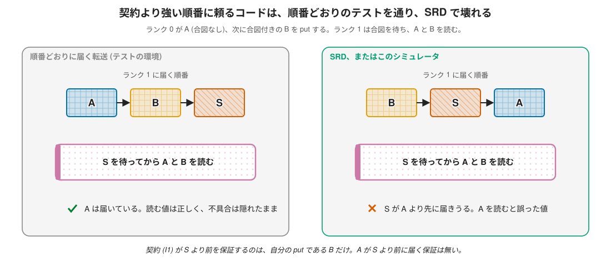
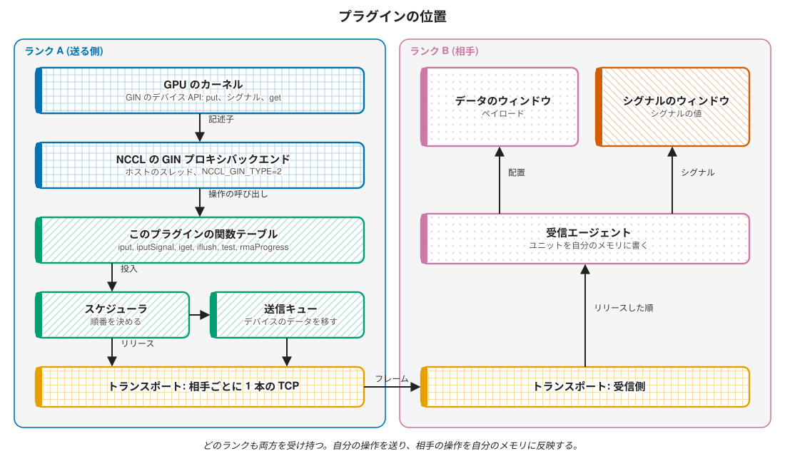
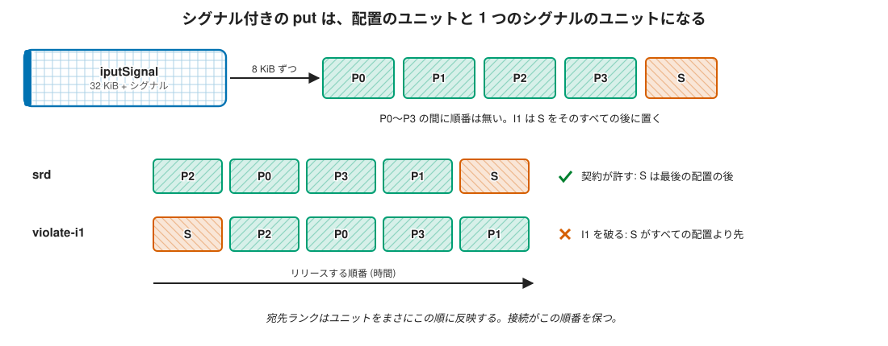
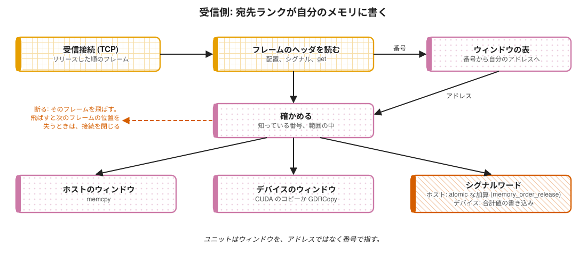
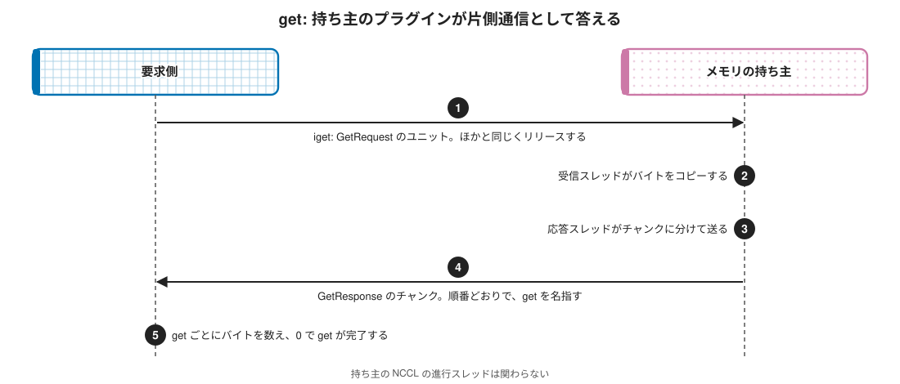

# アーキテクチャ

[English](architecture.md) | **日本語**

nccl-srdsim (プラグイン、シミュレータとも呼ぶ。どちらも同じもの) は、GPU が始める書き込みを、SRD のような順番を保たないファブリックが許すどんな順番でも届ける NCCL のプラグインである。そのファブリックに向けて書いたコードが、そこでしか起こさない不具合を、普通の GPU ホストで再現できるようにする。

## 前提

**ランク** は NCCL のジョブの 1 つのプロセスで、ふつうは 1 つの GPU を受け持つ。**コミュニケータ** は、NCCL がつないだランクの集まりである。GIN (GPU-Initiated Networking) は、GPU のカーネルが、別のランクのメモリに書き込む (**put**)、そこから読む (**get**)、そこにある 64 ビットのカウンタを増やす (**シグナル**) ための NCCL の API である。そのランクのコードはシグナルを待つ。put はシグナルを伴えるので、待っている側は、その put のデータがそろったことが分かる。この文書では、put を書き込む先のランクを **宛先ランク**、コミュニケータのほかのランクを **相手** と呼ぶ。

NCCL はこれらの操作を **RMA プラグイン** (RMA は remote memory access) に渡す。ランクの間で操作を運ぶホストのライブラリである。SRD (Scalable Reliable Datagram、AWS EFA のトランスポート) は **信頼性がある** が **順番を保たない**。どのメッセージもちょうど 1 回届くが、順番は決まっていない。SRD の上に作った RMA プラグインが保証するのは、GIN の契約 (次の節) が定める順番だけである。

## 何を解決するか

普通の (弱い) シグナルについて、GIN が約束する順番は 1 つだけである。シグナルは、自分の put のバイトがすべて反映された後でしか見えない ([NCCL の RMA プラグインの仕様](https://github.com/NVIDIA/nccl/blob/ad2d192c1f279aefcaf340f67e07880b65a1116b/plugins/rma/README.md#L92-L97)。この文書では不変条件 **I1** と呼ぶ)。それより前に出した put については、同じ宛先ランクへのものでも、何も約束しない。そのため、シグナルを待ってから前の put を読むコードは誤っているが、トランスポートがたまたま順番どおりに届けると、この誤りは表に出ない。

シミュレータは、契約が許すこの入れ替えをわざと作る。わざと I1 を破ることもでき (`violate-i1` モード)、シグナルが守るデータがそろっていないときにテストが本当に失敗するかを確かめられる。

## 用語

| 用語 | この文書での意味 |
|---|---|
| 操作 | NCCL からの 1 回の呼び出し。put、シグナル付きの put、シグナルだけ (大きさ 0 のシグナル付き put)、get のどれか。メモリの持ち主の側では、get への応答も操作になる |
| ユニット | スケジューラがリリースするもの。配置 (put のペイロードの 1 チャンク)、シグナル、get の要求のどれか |
| リリース | スケジューラがユニットを送信側に渡すこと。リリースの順番を決めるのが配送のモードである |
| 反映 | 宛先ランクの受信エージェントが、ユニットを宛先ランクのメモリに書くこと |
| ローカル完了 | `test` が報告するもの。put とシグナルでは、操作の送り元を再利用してよいことを表し、宛先ランクについては何も言わない。get では、データが手元のウィンドウにあることを表す。ただし例外が 2 つあり、どちらもデータを届けない。dry run (`SRDSIM_DRY_RUN=1`) の get はすぐに終わる。応答が届く前にプラグインのコンテキストを壊した get は、データが届かなかったことをログに書くだけで、終わったと報告される |
| ウィンドウ | 登録したメモリの範囲。ユニットはウィンドウを番号で指し、各ランクが番号を自分のアドレスに直す |
| プラグインのコンテキスト | `createContext` が返すもの。NCCL が求めた数の RMA コンテキストを持ち、それらすべてに 1 つのスケジューラを使う |
| RMA コンテキスト | コミュニケータの上の、NCCL の順番の単位。操作ごとのコンテキストの番号で指す。契約が約束する順番は RMA コンテキストと宛先ランクの組ごとのもので、RMA コンテキストをまたいでは何も約束しない |
| 接続 | 2 つのランクの間の、片方向の TCP の接続 |

## プラグインの位置

NCCL の GIN プロキシバックエンド (`NCCL_GIN_TYPE=2`) は、GPU のカーネルが出した操作を 1 つずつ受け取って RMA プラグインの関数を呼ぶ、ホストのスレッドを動かす。呼ぶ関数は `iput`、`iputSignal`、`iget`、`iflush`、`test`、`rmaProgress` である。このプラグインは、その関数テーブルを提供する。宛先ランクのメモリへの書き込みは、NIC ではなくプラグインの受信側がすべて行うので、書き込みが効く順番はプラグインが決める。

| 部品 | 受け持つこと |
|---|---|
| アプリケーションの GPU のカーネル | NCCL の GIN のデバイス API で put、シグナル、get を出し、シグナルを待つ |
| NCCL の GIN プロキシバックエンド | 操作をプラグインの呼び出しに変え、`rmaProgress` と `test` を呼ぶホストのスレッド |
| このプラグインの送信側 | 操作をユニットに分け、リリースの順番を決め、ユニットを宛先ランクへ送る |
| このプラグインの受信側 (受信エージェント) | 宛先ランクで、各ユニットをリリースされた順にそのランク自身のメモリに書く |

どのランクも送信側と受信側の両方を受け持つ。自分の操作を送り、相手の操作を自分のメモリに反映する。本番で別の GIN のバックエンドを使うコードにとってこれが何を意味するかは、[再現しないもの](#再現しないもの) に書いた。

## シグナル付きの put の一生

シグナル付きの put は 6 つの手順を通る。番号は図と同じである。

1. **投入。** NCCL のプロキシのスレッドが、送り元、大きさ、送り先、宛先ランク、シグナルを渡して `iputSignal` を呼ぶ。プラグインはメモリのハンドル (ウィンドウを登録したときに返したもの) をウィンドウの番号に直し、操作を、RMA コンテキストの番号を付けて、呼び出しを受けたプラグインのコンテキストのスケジューラに投入し、すぐに戻る。
2. **分割。** スケジューラはペイロードを `ceil(大きさ / チャンク)` 個の配置のユニット (`SRDSIM_CHUNK_BYTES`、既定は 8 KiB) に分け、シグナルのユニットを 1 つ足す。
3. **リリース。** `rmaProgress` を呼ぶたびに、コミュニケータのすべてのプラグインのコンテキストのスケジューラから最大 8 個ずつユニットを取り出す。どのユニットをどの順に出してよいかは配送のモード (次の節) が決める。ユニットは、宛先ランクのアウトボックスに空きを予約してからリリースするので、リリースしたユニットが空きの不足で断られることはない。アウトボックスがいっぱいの宛先への操作は待ちのまま残り、ほかの宛先への操作はふだんどおりリリースされる。ランダムなモードは `SRDSIM_SEED` (シード) で初期化した乱数を使うので、投入と進行の呼び出しが同じなら、リリースの順番も同じになる。
4. **送信。** リリースしたユニットは、リリースした順に宛先ランクの接続へ書く。ユニットの送り元がデバイスのメモリなら、ユニットはまずピン留めしたホストのメモリへコピーされ、送信キューは、そのコピーが終わるまで、同じ宛先ランクへの後のユニットを送らない。そのため、コピーにかかる時間がスケジューラの決めた順番を変えることはない。(CPU が GPU のメモリを直接読み書きできるようにするライブラリの GDRCopy を使うときと、`SRDSIM_ASYNC_DELIVERY=0` のときは、コピーをキューに入れずに、そのつど終わるのを待つ。)
5. **反映。** 宛先ランクで、受信エージェントがフレーム (接続で送られた 1 つのユニット) を読み、ウィンドウの番号を自分のアドレスに直し、範囲を確かめてから、バイトを書くか、シグナルワードに足す。
6. **完了。** `test` は、put とシグナルについては、操作のユニットをすべてリリースし、送信キューに 1 つも残っていないときに、終わったと報告する。送り元を再利用してよいことを表すだけで、宛先ランクについては何も分からない。get については、応答のバイトがすべて手元のウィンドウに反映されたときに、終わったと報告する。`iflush` は、プラグインのコンテキストのスケジューラが投入されたものをすべてリリースし、そのユニットが送信キューに残っておらず、そのコンテキストが出したすべての get のバイトがすべて反映されたときに終わる。コンテキストの番号、メモリのハンドル、ランクは使わず、この条件は flush に `test` を呼ぶたびに調べる。そのため、プラグインのコンテキストのすべての RMA コンテキストとすべての宛先、それに flush の後に投入した操作まで待ち、インターフェースが求めるより多くを待つことになる。宛先のアウトボックスがいっぱいで待っている操作があると、そのプラグインのコンテキストの flush はすべて待つ。put が宛先ランクで反映されるのは待たない。

TCP の接続は信頼性があり順番を保つので、自分からは入れ替えない。受信のスレッドは、フレームが届いた順に書き込みを出す。ホストへの書き込みは次のフレームを読む前に終わり、デバイスへの書き込みはその順に 1 つの CUDA のストリーム (CUDA の、順番を保つ仕事の列。TCP の接続とは別のもの) へ入るか、終わるのを待つ。そのため、1 つの RMA コンテキストのリリースの順番が、そのコンテキストの書き込みが宛先ランクで効く順番になる。シードが決めないのは、RMA コンテキストどうしと、送り手どうしの間の混ざり方である。

## 配送の契約とモード

スケジューラは 1 つの決まりに従う。契約が順番を約束しないところはすべて入れ替え、約束する順番はすべて守る。入れ替えが少なすぎると、シミュレータが作るべき順番が隠れる。多すぎると、契約を守るファブリックでは起こりえない不具合を報告してしまう。契約は次のとおりである。

- **I1。** 弱いシグナルは、自分の put のバイトがすべて反映された後でしか見えない。それより前の put やシグナルについては何も約束しない。
- **強い** シグナルは、さらに、同じ RMA コンテキストから同じ宛先ランクへの、それより前のすべての put とシグナルが反映された後でしか見えない ([シグナル](#シグナル) を参照)。
- put は、同じ宛先ランクへのものでも、互いにどんな順番でも反映される。1 つの put のチャンクも、どんな順番でも反映される。

スケジューラは、NCCL が `rmaProgress` を呼んだときに、プラグインのコンテキストの、すべての RMA コンテキストの未リリースの操作から選ぶ。NCCL が投入し、次の操作が投入される前にプラグインがリリースし終えた操作は、追い越されようがない。そのため、実行がたどり着く順番は、モードだけでなく、NCCL がプラグインをどう呼ぶかにもよる。

`SRDSIM_MODE` でモードを選ぶ。

| モード | I1 を守るか | 何のためのものか |
|---|---|---|
| `srd` (既定) | 守る | 契約が許す順番を、シードごとにランダムに選ぶ |
| `inorder` | 守る | プラグインのコンテキストのすべての RMA コンテキストと宛先を通して、投入した順。宛先のアウトボックスがいっぱいの操作は飛ばすので、ほかの宛先への操作が先に出る。陽性の対照であり、ここで失敗するコードは、順番と関係のない理由で失敗している |
| `peer-seq` | 守る | RMA コンテキストと宛先ランクの組ごとに投入した順で、1 つの操作のチャンクは入れ替える。契約が約束するより強い順番で、aws-ofi-nccl (SRD の本番の RMA プラグイン) がたまたま保つもの。ここで通り `srd` で失敗するコードは、契約より多くに頼っている |
| `reverse-ops` | 守る | プラグインのコンテキストの新しい操作から、チャンクは番号の小さい順。投入した順ではない、最も簡単な順番 |
| `signal-last` | 守る | プラグインのコンテキストの、未リリースのすべての操作のペイロードを出してからシグナルを出す。ペイロードとシグナルを、契約が許す限り離す。アウトボックスがいっぱいで待っているペイロードは、ほかの宛先のシグナルを止めない |
| `defer-one` | 守る | プラグインのコンテキストの、未リリースの最も古い操作を、ほかがすべてリリースされるまで止める。1 つの経路だけが遅いときに当たる。チャンクの順はランダム。ほかの操作が空きを待っているだけのあいだも止めたままにする |
| `violate-i1` | 破る | 未リリースのシグナルを、その put の配置がリリースされたかに関係なく、何よりも先にリリースする。強いシグナルの保留も無視する。陰性対照 |

## スレッド、RMA コンテキスト、接続

各ランクは、1 つのコミュニケータについて 3 種類のスレッドを動かす。NCCL の GIN プロキシのスレッドが操作を投入して進め、プラグインの受信エージェントが、受信接続ごとに 1 つのスレッドで操作を反映し、プラグインの応答スレッドが get の応答を送る。

- **スレッド。** NCCL の GIN プロキシのスレッドが、投入の関数、`rmaProgress`、`test` を呼ぶ。宛先ランクでは、受信エージェント (コミュニケータごとに 1 つ) が、受信接続ごとに専用のスレッドでフレームを読んで反映する。フレームが get の要求なら、そのスレッドが求められたバイトをコピーしてコミュニケータの応答スレッドに渡し、応答スレッドが応答を送る。
- **RMA コンテキスト。** `createContext` は、NCCL が求める数の RMA コンテキストを持つプラグインのコンテキストを作る。その操作は 1 つのスケジューラとミューテックスを共有し、スケジューラは RMA コンテキストと宛先ランクの組ごとに順番を保つ。
- **接続。** 各ランクは `listen` で、すべてのインターフェースに TCP の待ち受けを開き、相手が接続すべきアドレスを、NCCL がランクの間で交換するハンドルとして返す。アドレスは、`SRDSIM_LOCAL_IP` があればそれ、無ければデフォルトルートのアドレスである。`connect` では、各ランクがすべての相手に接続し、すべての相手からの接続を受けるので、どの 2 ランクの間にも向きごとに 1 本の接続ができる。自分あての通信もソケットペアで同じ通り道を通る。NIC も、自分に送った書き込みを届け、入れ替えうるからである。ソケットは IPv4 で、フレームはバイト順を変換しないので、両端は同じビルドを同じアーキテクチャで動かす必要がある。

## 部品

プラグインは、1 つのソースファイルと、それがインクルードする 4 つのヘッダでできている。5 つ目のヘッダはテストだけが使う。GPU なしで正しさを決められる仕組みはヘッダに置いているので、どの Linux のホストでもテストできる。

| ファイル | 受け持つこと |
|---|---|
| `src/srdsim_schedule.h` | スケジューラ。操作をユニットに分け、配送のモードに従ってリリースの順番を決める |
| `src/srdsim_transport.h` | トランスポート。フレームの形式、接続、相手ごとの送信待ちの領域 (アウトボックス)、受信エージェント |
| `src/srdsim_async.h` | 送り元がデバイスのメモリで、ホストへのコピーがまだ終わっていないユニットのための送信キュー。ユニットの型のテンプレート |
| `src/srdsim_mapping.h` | GDRCopy の BAR のマッピングと、ピン留めしたステージング領域 (一時置き場)のアドレスの計算 |
| `src/srdsim_impair.h` | わざと入れるインペアメント (遅れ、まとめ送り、詰まり、止まった接続、遅れるシグナル)。liveness のテストが使う。プラグインはまだ使っていない ([#18](https://github.com/littlemex/nccl-srdsim/issues/18)) |
| `src/nccl_rma_srdsim.cc` | 関数テーブル、接続の準備、ウィンドウの登録、デバイスのメモリへの配送、完了、診断 |

## トランスポートと受信側

送信側は、宛先ランクのメモリに書き込まない。フレームのヘッダとバイトを接続で送り、宛先ランクの受信エージェントが自分のウィンドウに書く。このやり方なら、プロセスの間で GPU のピアアクセスを使うことも、確保したメモリをプロセスの外へ渡すことも要らず、1 台のホストの中でも、ホストをまたいでも、同じように動く。

ユニットはウィンドウを、アドレスではなく番号で指す。ウィンドウの登録 (`regMrSym`) は全ランクで一斉に同じ順に行うので、どのランクも同じウィンドウを登録する限り、番号はどのランクでも一致する。宛先ランクは番号を自分のベースアドレスに直す。

フレームはどれも、56 バイトのヘッダの後に `length` バイトのペイロードが続く形である。`length` は種類によらず必ず後に続くバイト数を数えるので、受信エージェントは 1 つを断った後でも次のフレームを見つけられる。get の要求はペイロードを持たないので、`length` は 0 で、読むバイト数は `value` で運ぶ。

| 層 | 受け持つこと | 再送と失敗 | 何を指すか |
|---|---|---|---|
| 接続 (TCP) | あるランクから別のランクへの、信頼性があり順番を保つバイト列 | TCP が再送する。接続が切れると、その接続で送るプラグインのコンテキストが失敗する | 2 ランクの組と向き |
| アウトボックス | 追加したがまだ接続に書いていないバイト。リリース中のユニットのために予約した空きと合わせて、相手ごとに 64 MiB まで。送るたびにソケットが受け取るだけ押し出し、残りは `rmaProgress` と応答スレッドが押し出す | スケジューラがリリースしたユニットは予約した空きを使い、断られない。それ以外のフレーム (get の応答) は、たまっている分と予約の分の横に収まらなければ断られ、送り手がやり直す。アウトボックス全体より大きいフレームは、アウトボックスが空のときに受け付ける | 相手 |
| フレーム | 1 つのユニット。種類、書く場所、長さ | 再送しない。知らないウィンドウや範囲の外を指すフレームは飛ばす。受け手のフレームの上限 `max(SRDSIM_CHUNK_BYTES, 4 MiB)` より長いフレームと、知らない種類のフレームは、接続を閉じる。`SRDSIM_CHUNK_BYTES` は 64 MiB までで、4 MiB を超える値ではすべてのランクで同じ値にする。そうしないと、大きいフレームが接続を閉じさせる | `window` と `offset` が書く場所を指す。get の応答では `op_id` が要求側の get を指す |
| ウィンドウの表 | ウィンドウの番号を、このランクのアドレスに直す | 登録が外れた番号は断る | `window` |

飛ばした配置は失われるが、その操作のシグナルは届けば反映される ([#24](https://github.com/littlemex/nccl-srdsim/issues/24))。届かない get の応答は、その get と、そのプラグインのコンテキストのまだ終わっていない `iflush` をすべて待たせたままにする ([#37](https://github.com/littlemex/nccl-srdsim/issues/37))。これは、持ち主が要求を断ったとき、書き込みが失敗したとき、応答が送られる前に持ち主のコミュニケータが閉じたときに起きる。閉じた後の応答スレッドは要求を断り、送っていない応答は 1 秒で諦める。

## デバイスのメモリへの配送

GPU で危ないのはデッドロックである。アプリケーションのカーネルがデータを待って GPU に居座り続け、そのデータを届けるコピーが、アプリケーションのモジュールの読み込みや解放の後ろに並んでしまう。読み込みや解放は、CUDA コンテキストのロックを、居座るカーネルが終わるまで持ち続ける。デバイスのウィンドウへの 4 つの書き方は、コピーが何の後ろに並びうるかが違う。

| 書き方 | すること | 要るもの | 書き込みが何の後ろで待ちうるか |
|---|---|---|---|
| 専用の CUDA コンテキスト (既定) | プラグインが自分で作った CUDA コンテキストからコピーする | `ncclMemAlloc` で確保したデバイスのウィンドウ (VMM の確保。マッピングが 1 つの CUDA コンテキストではなくプロセスに属する)。登録はそれ以外を断る | アプリケーションが自分の CUDA コンテキストで行うことの後ろでは待たない。たとえば、カーネルが待っている間のモジュールの読み込み (DeepEP の JIT がそうする)。ただし、カーネルが居座っている間はコピーのたびに GPU のタイムスライスを待つので、コピーは遅い |
| primary (`SRDSIM_DELIVERY_CONTEXT=primary`) | デバイスの primary context (既定の CUDA コンテキスト) からコピーする | どんな確保でもよい | そのコンテキストでのアプリケーションのモジュールの読み込みと解放。上のデッドロックであり、それを再現するためのもの |
| green (`SRDSIM_DELIVERY_CONTEXT=green`) | green context (デバイスが許す最も小さい SM、つまりストリーミングマルチプロセッサの組に限った CUDA コンテキスト) からコピーする | VMM のウィンドウと CUDA 12.4 以降 | GPU のタイムスライスは待たないが、モジュールの読み込みが持つ primary context のロックは待つ。カーネルが待っている間に何も読み込まず何も解放しないアプリケーション向け |
| GDRCopy (ビルドの選択) | ウィンドウを GPU の BAR (PCIe のメモリの窓) でプロセスにマップし、CPU が書く | `/dev/gdrdrv`、そして primary でなければ VMM のウィンドウ。GPU のページに揃っていないウィンドウは、終わるのを待つ CUDA のコピーに切り替わる | GPU の何も待たない |

## シグナル

シグナルのユニットは、宛先ランクのシグナルのウィンドウにある 64 ビットの値 (シグナルワード) に足す。足すのは、`NCCL_GIN_SIGNAL_OP_ADD` ならシグナルの値、それ以外なら 1 である。

- **ホストのウィンドウ。** エージェントは、同じ接続から置いたペイロードのバイトの後で、`memory_order_release` のアトミックな加算をする。アプリケーションの待つコードのように `memory_order_acquire` でシグナルワードを読む読み手には、その後、それらのバイトが見える。トランスポートのテストの T12 がそのような読み手で、加算を relaxed に変えると ThreadSanitizer が報告する。
- **`NCCL_NET_MR_FLAG_SIGNAL_NEVER_RESET` 付きで登録したデバイスのウィンドウ。** プラグインがシグナルワードごとに 0 から始まる合計を持ち、それを 8 バイトの整列した書き込みで書く。このフラグは、アプリケーションがこの値を消さないことを表す。NCCL は、バックエンドが対応していれば、GIN のプロキシのシグナルのウィンドウにこのフラグを付ける ([`gin_host_proxy.cc`](https://github.com/NVIDIA/nccl/blob/ad2d192c1f279aefcaf340f67e07880b65a1116b/src/gin/gin_host_proxy.cc#L578))。NCCL もこのプラグインも、そこから書き手はプラグインだけだと考える。合計値の書き込みがアトミックな加算と同じになるのは、ウィンドウを登録したときにワードが 0 で、合計の計算と書き込みが順番どおりに行われるときである。プラグインは、それぞれの合計を 1 つのロックのもとで計算して書く。カーネルを起動しないので、アプリケーションのカーネルが SM をすべて使っていても、配送に SM は要らない。
- **それ以外のデバイスのウィンドウ。** アプリケーションが自分で値を消すことがあるので、小さなカーネルで加算する。カーネルは最初のデバイスのウィンドウを登録したときに NVRTC でコンパイルし、操作の配置を運ぶのと同じストリームで起動する。`SRDSIM_SIGNAL_KERNEL=1` なら、2 つのやり方を比べられるように、すべてのデバイスのウィンドウでカーネルを使う。ウィンドウの登録を外すときは、残っている加算が終わるのを待つ。
- **強いシグナル。** SRD に強いシグナルは無いが、NCCL はこれを頼むことがあり、投入の関数がエラーを返すと NCCL の GIN プロキシのスレッドは二度と動かない。そこでプラグインは強いシグナルを受け入れ、スケジューラは、同じ RMA コンテキストから同じ宛先ランクへの前の操作がすべてリリースされるまで、それを保留する。ほかの RMA コンテキストの操作は保留の理由にならない。図では、S! が前の操作 A と B を待つ。v16 の関数テーブルを定義する NCCL のヘッダでビルドすると、プラグインは `flushesAllPutsOnAnySignal` も false と報告する。シグナルが届いても、ほかの相手からの put が反映済みとは限らない。

## get

get は、RDMA の読み出しと同じく片側通信である。持ち主のプラグインが、持ち主の NCCL の進行スレッドを使わずに答える。

- **要求。** `iget` は、プロセスの中で使い回さない番号で get を記録し、まだ届いていないバイト数を持たせて、その番号を運ぶ GetRequest のユニットを投入する。大きさ 0 の get は、要求を送らずにすぐ完了する。
- **応答。** 持ち主では、要求を読んだ受信スレッドがウィンドウからバイトをコピーし、コミュニケータの応答スレッドに渡す。応答スレッドはそれを `SRDSIM_CHUNK_BYTES` のフレームに分け (ただし、どの受け手も受け付ける 4 MiB まで)、要求側ごとに要求が届いた順に送る。要求側を 1 つの応答ずつ順番に回り、送るときに待つことはない。アウトボックスに断られたフレームは後の順番でやり直すので、読むのをやめた要求側が止めるのは自分への応答だけである。要求側ごとにたまるコピーの量に上限は無い。応答は持ち主のスケジューラを通らないので、配送のモードがそのチャンクを入れ替えることはない。
- **完了。** 応答のフレームは、どれも番号で get を名指す。要求側は、フレームの長さをその get から引き、プラグインのコンテキストの `iflush` が待つ合計からも引く。`test` は、残りのバイトが 0 になった get を終わったと報告する。記録の無い番号への応答は捨てる。プラグインのコンテキストを壊すと、残っている get は打ち切りになる。遅れて届いた応答は捨て、`test` は、データが届かなかったことをログに書いて、その get を終わったと報告する。

SRD 向けのデバイス側の GIN のバックエンドである EFA-GDA に get は無い。この通り道は、get を持つ GIN のバックエンドに向けて書いたコードのためにある。たとえば aws-ofi-nccl のホストのプロキシのバックエンドで、その `iget` は [`fi_read`](https://github.com/aws/aws-ofi-nccl/blob/2475c4c736907e68ebeadb3848f31231ee4a44d0/include/rdma/gin/nccl_ofi_gin_reqs.h#L414) である。

## インペアメントと診断

プラグインは、まだインペアメントを使っていない ([#18](https://github.com/littlemex/nccl-srdsim/issues/18))。`src/srdsim_impair.h` は、遅い、まとめて届く、詰まる、一部が止まるファブリックを作るが、データを失うファブリックは作らない。使っているのは liveness のテストだけである。インペアメントが狙うのは liveness (進行性) の不具合 (何かが進まなくなる) で、実機ではしばしば最も見つけにくい。順番の不具合 (到達可能な状態のどこかが正しくない) は、配送のモードが狙う。

診断には `SRDSIM_LOG_OPS=1` がある。すべての操作をログに残し、停止の監視も動かす。監視は、`SRDSIM_STALL_MS` の間どのユニットも反映されないとき、各スレッドが最後にどこにいたかを報告する。設定はすべて [設定のリファレンス](configuration.ja.md) にある。

## テスト

GPU なしで決められる性質は、プルリクエストのたびに、ヘッダと、ビルドしたプラグインの関数テーブルに対して確かめる。プラグインを NCCL の下で動かすのは GPU のテストだけで、手動で実行する。

| テスト | 確かめること |
|---|---|
| `test_srdsim_schedule` | 7 つのモードそれぞれについて 64 のシードで、投入したバイトがすべてちょうど 1 回、正しい場所へリリースされること。I1 を守る 6 つのモードはシグナルを早く出さず、`violate-i1` は出すこと。各モードを決める順番が成り立つこと。シードが順番を再現すること。60,000 のシードで、2 つの操作の場合が、契約が許す 2,520 通りの順番すべてに届き、許さない順番には 1 つも届かないこと |
| `model_srdsim_schedule_exhaustive` | 十分小さい構成で、スケジューラが到達できるすべての状態を調べる。`srd` と `inorder` ではシグナルを put より先に出す状態は無く、`violate-i1` には少なくとも 1 つあること。どのユニットもちょうど 1 回リリースされること。どの道筋も終わること |
| `test_srdsim_transport` | 本物の TCP の接続で、バイトとシグナルがすべてちょうど 1 回届くこと。反映の順番がリリースの順番と同じであること。シグナルワードを acquire で読む読み手が、その前に置かれたバイトを見ること (T12) |
| `model_srdsim_framing` | 扱うフレームの種類と結果のあらゆる並びで、各フレームの後、受信エージェントが次のフレームの先頭にいるか、接続が閉じていること |
| `test_srdsim_adversarial` | 悪意のある相手と誤った使い方。とても大きなフレームの長さ、あふれる `offset + length`、出していない操作の番号、大きさ 0 のチャンク、送信側と競合する終了。どれも断るか、耐えること |
| `test_srdsim_async` | コピーがどんな順で終わっても送信キューが宛先ランクごとの順番を保つこと。最後のユニットが出るまで操作が終わらないこと |
| `test_srdsim_get` | get の要求と応答が、正しい送り元、送り先、持ち主を運ぶこと |
| `test_srdsim_mapping` | BAR のマッピングと staging の領域の計算を、すべてのスロットとページのずれで確かめる。素朴な計算があふれるように選んだ値も含む |
| `test_srdsim_liveness` | インペアメントの下での経過時間の上限。遅いことと、決して終わらないことを見分ける |
| `test_plugin` (`tests/plugin`) | ビルドしたプラグインを `dlopen` で読み込み、関数テーブルの版を 1 つずつ、NCCL の GIN プロキシと同じ呼び方で動かす。プロキシのスレッドは、NCCL のまとめ方の規則で一括して投入し、出した順に `test` して宛先ランクごとの先頭で完了を確定し、put の送り元を完了の確定時に上書きする。ランクごとに 1 プロセス。場面は、I1 とその陰性対照、強いシグナルとその対照、RMA コンテキスト、持ち主を止めたときや動かさないときの get と flush、止めた宛先への送り先の詰まり、get を残したままのコンテキストの作り直し、断られた要求と dry run、4 MiB を超えるフレーム、通信中の登録である。GPU があれば、`NCCL_NET_MR_FLAG_SIGNAL_NEVER_RESET` の有無でデバイスのウィンドウへのシグナルの反映を確かめる 2 つの場面も走り、GPU が無ければ飛ばす |

CI は、ホストのテストを AddressSanitizer、UBSan、ThreadSanitizer の下でも走らせる。対応する NCCL の各リリースのヘッダに対して、配送の構成ごとにプラグインをビルドし、CUDA 12 と 13 で、GDRCopy の有無それぞれでもビルドする。NCCL が探す関数テーブルがエクスポートされていることを確かめ、ホストだけのビルドを `dlopen` で読み込む。`test_plugin` を、プラグインがエクスポートするすべての関数テーブルの版について、ホストだけのビルド、各サニタイザーの下、そして GPU は無いがドライバのライブラリがある CI のマシンでの CUDA のビルドで走らせる。NCCL を通したデバイスのウィンドウへの配送を動かすのは GPU のテストだけである ([#8](https://github.com/littlemex/nccl-srdsim/issues/8))。

## 再現しないもの

シミュレータが再現するのは、NCCL の GIN プロキシバックエンドを通る配送の順番であり、それより下のものは再現しない。

| 再現しないもの | 理由 |
|---|---|
| NCCL の集団通信 (all-reduce、all-gather、send と receive) | ネットワークプラグインのインターフェースを使い、このプラグインはそれを実装しない |
| デバイス側の GIN のバックエンド (InfiniBand と RoCE 向けの GDAKI、SRD 向けの EFA-GDA) と、NVSHMEM の上に作ったもの | GPU が NIC を直接動かし、ホストの関数テーブルを通らない。本番でそれを使うコードは、ここではそのバックエンドが約束する契約に照らして確かめるのであり、そのバックエンドの上で確かめるのではない |
| ファブリックが名乗れる能力 | NCCL のプロキシバックエンドは、どの RMA プラグインについても強いシグナルに対応していると報告するので、プラグインは SRD にそれが無いと言えない。代わりに強いシグナルを実装する |
| ワークリクエストの形、ドアベル、完了キューの上限、PCIe と MMIO の順序 | デバイス側の通り道と、ハードウェアのメモリモデルの性質である |
| 損失と重複 | SRD は信頼性がある |
| 帯域、レイテンシー、秒で測るもの | ペイロードはホストのメモリを通る。シミュレータは性能について何も主張しない |
