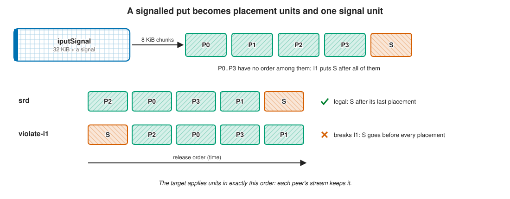
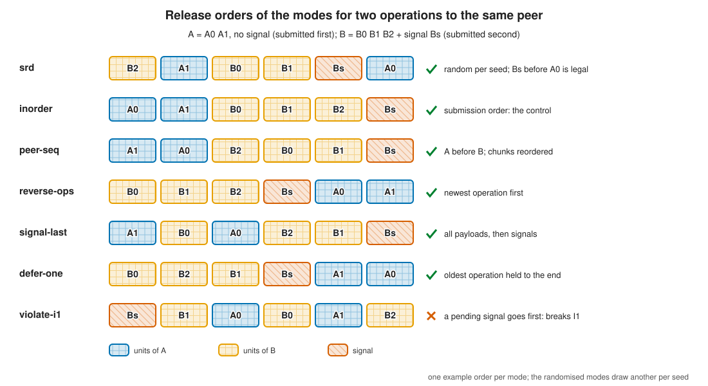

# Architecture

nccl-srdsim is an NCCL RMA plugin. NCCL loads it as the RMA backend behind its GIN proxy backend, hands it the remote puts, signals and gets that GPU kernels issue through NCCL's GIN device API, and the plugin delivers them in an order that an unordered, reliable fabric such as SRD is allowed to produce. This document explains where the plugin sits, how one operation travels through it, which ordering contract each delivery mode keeps or breaks, and how the pieces are tested.

## Terms

| Term | Meaning here |
|---|---|
| Operation | One call from NCCL: a put, a signalled put, a bare signal (a signalled put of size 0) or a get |
| Unit | What the scheduler releases: a placement (one chunk of an operation's payload), a signal, or a get request |
| Released | Handed by the scheduler to the send side |
| Sent | Written to the peer's stream |
| Applied | Written into the target's memory by the target's receiving agent |
| Locally complete | What `test` reports: the operation's source may be reused. Says nothing about the target |

## Where the simulator sits

NCCL offers several GIN backends. The device-side ones (GDAKI, EFA-GDA) let the GPU drive the NIC directly, and no host code is on their data path. The proxy backend (`NCCL_GIN_TYPE=2`) instead has a host thread take each operation the kernel posts and call the host RMA plugin interface: `iput`, `iputSignal`, `iget`, `iflush`, `test` and `rmaProgress`. A signalled put arrives as a single `iputSignal` naming both the payload and the signal word, and a bare signal arrives as an `iputSignal` of size 0. The plugin performs both writes itself and decides their order. That is exactly the freedom a delivery simulator needs, and it needs no device code to have it.

Every rank runs both halves of the figure: it sends its own operations and applies the ones its peers send to it.

Two consequences bound what a passing run means.

- Only traffic through the proxy backend is simulated. Code that will run on a device-side backend in production is tested here against the contract that backend promises. The device-side backend itself is not tested.
- NCCL's proxy backend reports `supportsStrongSignals` and `supportsVASignals` as true on the plugin's behalf, and the RMA interface has no call through which a plugin could say otherwise. The plugin cannot advertise a fabric's capabilities; it can only imitate that fabric's delivery order. It implements strong signals rather than refusing them (see [Signals](#signals)).

## Components

| File | Responsibility | Depends on |
|---|---|---|
| `src/srdsim_schedule.h` | The scheduler. Splits each operation into units and decides the order in which they are released, according to the delivery mode | nothing: no NCCL, no CUDA, no sockets |
| `src/srdsim_transport.h` | The wire. One TCP stream per peer on the sender, and a receiving agent per peer on the target that applies each unit to the target's own memory | the scheduler's unit type |
| `src/srdsim_async.h` | The send queue for units whose source is device memory still being copied to the host. Keeps per-peer order while copies complete out of order | the unit type; readiness and sending are supplied by the caller |
| `src/srdsim_mapping.h` | Address arithmetic for GDRCopy BAR mappings and the layout of the pinned staging pool | nothing |
| `src/srdsim_impair.h` | Deliberate impairments: delay, bursts, backpressure, a frozen link, a lagging signal. All off by default | nothing |
| `src/nccl_rma_srdsim.cc` | The op table NCCL loads, connection setup, window registration, delivery into device memory, the signal kernel, completion, diagnostics | all of the above, NCCL's plugin headers, optionally CUDA and GDRCopy |

The scheduler, transport, send queue and mapping arithmetic are header-only and free of CUDA, so their properties are tested on an ordinary host (see [Testing](#testing)).

## Threads, contexts and connections

- **Connections.** In `listen`, each rank opens a TCP listening socket (on the address in `SRDSIM_LOCAL_IP`, or the host's own) and returns its address as the connection handle NCCL exchanges between ranks. In `connect`, each rank dials every peer and accepts a connection from every peer, so every pair has a stream in each direction. Traffic to the rank itself goes over a socket pair through the same path, because a real NIC also delivers, and may reorder, writes a rank sends to itself.
- **Contexts.** NCCL may create several RMA contexts on one communicator. Each has its own scheduler. Ordering, including the strong-signal hold, is per context and peer; nothing is ordered across contexts.
- **Threads.** NCCL's GIN proxy thread calls the submit entry points, `rmaProgress` and `test`. On the target, one receiving-agent thread per peer reads and applies that peer's frames. Each context's scheduler is guarded by the context's mutex; the communicator's mutex guards its list of contexts.

## Life of a signalled put

1. **Submit.** The proxy thread calls `iputSignal`, naming the source handle and offset, the size, the destination handle and offset, the target rank and the signal. The plugin translates each memory handle into a window number, builds an operation, submits it to the context's scheduler and returns a request handle at once. An operation larger than 1 GiB is refused.
2. **Split.** The scheduler splits the payload into `ceil(size / chunk_bytes)` placement units (`SRDSIM_CHUNK_BYTES`, 8 KiB by default) and, because the put carries a signal, one signal unit.
3. **Release.** Release is pulled, not pushed: each call to `rmaProgress` asks the scheduler of every context on the communicator for up to eight units each (`SRDSIM_PROGRESS_ONE_CONTEXT=1` advances only the calling context). Which units may be released, and in what order, is the delivery mode (next section). In the randomised modes the choice comes from a generator seeded with `SRDSIM_SEED`, so the same sequence of submissions and progress calls reproduces the same order.
4. **Send.** Released units are written to the peer's stream in release order. When device memory is delivered by CUDA copies (the default without GDRCopy), a unit whose source is device memory is first copied to a pinned host staging slot asynchronously, and the send queue holds every later unit to the same peer until that copy has landed, so the copy's timing cannot change the order the scheduler chose. With `SRDSIM_ASYNC_DELIVERY=0`, or when pinned staging is turned off (`SRDSIM_PAGEABLE_STAGING=1`), each copy is waited for instead and the queue is not used.
5. **Apply.** On the target, the receiving agent for that peer reads each frame, resolves the window number to its own address, checks the bounds and writes the bytes, or adds to the signal word.
6. **Locally complete.** `test` reports the request done when every unit of the operation has been released and, when the send queue is in use, none is still in it. Like a NIC's local completion, that means the source may be reused, not that the data has been applied. `iflush` completes when the scheduler of the context it was issued on is idle, none of that context's units is still in the send queue, and every get that context is waiting for has been applied. Its `rank` argument does not narrow it to one peer.

A TCP stream is reliable and ordered, so it adds no reordering of its own. That is deliberate: every reordering comes from the scheduler, where a seed reproduces it, and the order in which units are applied at the target is the order in which they were released. The transport test checks that property directly. A placement is fully written before the agent reads the next frame, which is what makes the release order the order of visibility.

## The delivery contract and the modes

The default mode keeps the weak-signal guarantee of NCCL's [RMA plugin specification](https://github.com/NVIDIA/nccl/blob/ad2d192c1f279aefcaf340f67e07880b65a1116b/plugins/rma/README.md#L92-L97), which is what an unordered fabric provides:

- **I1.** A signal becomes visible only after every byte of its own put has been applied. Nothing is promised about earlier puts or signals.
- Puts are applied in any order relative to each other, also when they go to the same peer.
- The chunks of one put are applied in any order.

The scheduler follows one calibration rule: reorder wherever the contract promises no order, and preserve every order it does promise. Reordering less would hide the orderings the simulator exists to produce; reordering more would report failures that no conforming fabric can cause.

`SRDSIM_MODE` selects the mode:

| Mode | Keeps I1 | What it is for |
|---|---|---|
| `srd` (default) | yes | Any legal order, drawn at random per seed |
| `inorder` | yes | Submission order. The control: code that fails here fails for a reason that has nothing to do with ordering |
| `peer-seq` | yes | Submission order per peer, chunks within an operation reordered. Stronger than the contract; it matches how aws-ofi-nccl's GIN implementation retires received operations. Code that passes here but fails under `srd` relies on more than the contract |
| `reverse-ops` | yes | Newest operation first: the simplest order that is not submission order |
| `signal-last` | yes | Every payload of every pending operation, then the signals: payload and signal as far apart as the contract allows |
| `defer-one` | yes | The oldest pending operation held back until every other pending operation has been released, as when one path is slow. With only two operations, as in the figure, it coincides with `reverse-ops` |
| `violate-i1` | no | May release a signal before the rest of its put. A negative control: code that depends on I1 should fail under it for some seed, so a test that passes under every `violate-i1` seed is not checking the data its signal guards |

Every mode is sampled over many seeds for exactly-once delivery and for I1, and each mode's defining order is checked; `srd` and `inorder` are also checked by enumeration: for configurations small enough, the exhaustive model visits every state the scheduler can reach and finds none that releases a signal early, while `violate-i1` reaches at least one that does (see [Testing](#testing)).

## Transport and the receive side

The sender never writes into the target's memory. It ships a descriptor and the bytes over the stream, and the target's receiving agent writes into its own window. This avoids two things that are often unavailable: GPU peer access between processes, and exporting an allocation across a process boundary. It also works the same way within one host and across hosts.

A unit names a window by number rather than by address. Window registration (`regMrSym`) is collective, so every rank registers the same windows in the same order and the numbering agrees everywhere; each target resolves the number to its own base address. A real NIC works the same way: a put names a remote key, not a remote pointer.

A frame that names an unknown window, or that would run past the end of its window, is reported and skipped, and the receiver stays positioned at the next frame. A frame that cannot be skipped safely, such as one whose header announces an impossible length, closes the link instead. The framing model checks that after every frame the receiver is at the start of the next frame or the link is closed. Get requests and replies travel as two further frame kinds on the same streams (see [Gets](#gets)).

## Delivery into device memory

When a window is device memory, the agent writes it in one of these ways.

- **CUDA copy from the plugin's own context** (default). The copy is issued on a CUDA context the plugin creates for itself, not on the device's primary context. While the application's kernels are resident and waiting for data this plugin has yet to deliver, a copy issued from the primary context can wait behind a module load the application performs on that context; DeepEP's JIT, for example, loads modules inside its dispatch. A copy issued from a second context does not wait behind that load. The windows must therefore be VMM allocations (`ncclMemAlloc`), whose mappings belong to the process rather than to one context, and registration refuses any other kind of device window.
- **CUDA copy from the primary context** (`SRDSIM_DELIVERY_CONTEXT=primary`). Accepts any allocation; it exists to reproduce the deadlock above.
- **CUDA copy from a green context** (`SRDSIM_DELIVERY_CONTEXT=green`). Copies over the smallest SM partition the device allows. Faster while kernels are resident, but a green context shares the primary context's lock, so it suits only applications that load no modules and free nothing while their kernels wait for this plugin.
- **GDRCopy.** With GDRCopy built in and `/dev/gdrdrv` present, device windows are mapped into the process through the GPU's BAR and written by the CPU, which does not wait for the GPU at all. The mapping arithmetic lives in `srdsim_mapping.h` so that it can be tested without a GPU.

## Signals

A signal unit updates a 64-bit word in the target's signal window: it adds the given value when the operation asks for `NCCL_GIN_SIGNAL_OP_ADD`, and adds one otherwise. Into host memory the update is a relaxed atomic add. The reader is expected to use an acquire load, and the plugin uses nothing stronger, so that a missing acquire in the code under test is not hidden. Into device memory it is a device-side atomic add, performed by a small kernel the plugin compiles at runtime with NVRTC. A device-side add is required because several peers update the same word through different receiving agents, and NCCL's kernels reset these counters on the device; a read-modify-write through the host would lose updates, and an absolute store from the host would overwrite a reset.

A strong signal orders every earlier put and signal on the same context and peer before itself, not just its own payload. SRD has no such operation, but NCCL may still request one, and a submit call that returns an error stops NCCL's GIN progress thread for good. So the plugin accepts strong signals, and the scheduler holds one until every earlier operation on that context and peer has been released.

## Gets

A get is sent as a small request naming the window, offset and length to read. The owner of that memory answers by submitting the reply on its own scheduler, on the first RMA context of its communicator, so the reply is chunked and reordered like any put and leaves only when the owner's `rmaProgress` runs. Each reply chunk is framed as a get reply carrying the requester's token, so the requester can count it against the gets it is waiting for. A get is locally complete once its request has been sent; the data having been applied is what `iflush` waits for. EFA-GDA has no get, so this path exists to exercise code written against the host proxy backends that do, not to model EFA-GDA.

## Impairments and diagnostics

Ordering failures are safety failures: some reachable state is wrong. The defects hardest to find on real hardware are usually liveness failures instead: something stops making progress. `srdsim_impair.h` provides settings that make the simulated fabric slow (`SRDSIM_DELAY_US_MIN`, `SRDSIM_DELAY_US_MAX`, `SRDSIM_APPLY_INTERVAL_US`), bursty (`SRDSIM_BURST`, `SRDSIM_BURST_PAUSE_US`), congested (`SRDSIM_SEND_BUFFER_BYTES`), frozen on one link (`SRDSIM_FREEZE_PEER`, `SRDSIM_FREEZE_AFTER_UNITS`, `SRDSIM_FREEZE_MS`), and late with signals (`SRDSIM_SIGNAL_LAG_US`). None of them drops or duplicates data, because SRD is reliable. All are off by default.

`SRDSIM_LOG_OPS=1` logs every operation and unit, and reports per-context progress counters when a run stalls. `SRDSIM_BACKTRACE=1` installs a crash handler that prints the plugin's own frames; it is off by default because a library should not take over its host process's fatal signals. A complete list of settings is tracked in #3.

## Testing

| Test | What it establishes |
|---|---|
| `test_srdsim_schedule` | For each of the seven modes over 64 seeds, every submitted byte is released exactly once, to the right place, and the six modes that keep I1 never release a signal early, while `violate-i1` sometimes does. Each mode's defining order: `inorder` never reorders, `reverse-ops` releases the newest operation first, `signal-last` releases every placement before any signal, `defer-one` holds the oldest operation until the others are released, `peer-seq` keeps each peer's submission order while still interleaving peers. A seed reproduces its order. Over 60,000 seeds, the two-operation case it samples reaches all 2,520 legal orders and no illegal one |
| `model_srdsim_schedule_exhaustive` | Every state the scheduler can reach, enumerated for configurations small enough: in `srd` and `inorder` none releases a signal before its put, in `violate-i1` at least one does, every unit is released exactly once, and every path ends, so the scheduler cannot wedge |
| `test_srdsim_transport` | Two processes over a real TCP connection: every byte and signal arrives exactly once, and the order of application at the target equals the order of release |
| `model_srdsim_framing` | Every sequence of frame kinds and outcomes: after each frame the receiver is at the start of the next one or the link is closed |
| `test_srdsim_adversarial` | A hostile peer and misuse: an enormous frame length, `offset + length` overflowing on the data and signal paths, an operation id never issued, a zero chunk size, a shutdown racing a sender. Each is refused or survived, and after each refusal the stream is still framed or the link is closed |
| `test_srdsim_async` | The send queue keeps per-peer order whatever the copies' completion order, and an operation stays incomplete until its last unit has left |
| `test_srdsim_get` | Get requests and replies carry the right source, destination and owner across the wire |
| `test_srdsim_mapping` | The BAR mapping and staging pool arithmetic, at every slot and across page offsets, including values chosen to overflow naive arithmetic |
| `test_srdsim_liveness` | Bounds on elapsed time under impairment: slow is distinguished from never |

These run on every pull request. CI also builds the plugin against the plugin headers of each supported NCCL release in each delivery configuration, checks that the op tables NCCL looks up are exported and that each configuration compiled the delivery path it claims, loads the host-only build with `dlopen`, and builds it through CMake against CUDA 12 and 13, with and without GDRCopy.

The host tests exercise the headers, not `nccl_rma_srdsim.cc`: the op table, connection setup, the delivery contexts, the signal kernel, completion and gets end to end are exercised only by a run under NCCL on a GPU, which is tracked in #8. The strong-signal hold is implemented in the scheduler but has no host test yet.

## What is not simulated

| Not simulated | Why |
|---|---|
| NCCL's collectives (all-reduce, all-gather, send/receive) | They use the network plugin interface, which this plugin does not implement |
| Device-side GIN backends (GDAKI, EFA-GDA) and anything built on NVSHMEM | The GPU writes the NIC directly; no host op table is on the path |
| Work-request encoding, doorbells, completion-queue limits, PCIe and MMIO ordering | These are properties of the device path and the hardware memory model |
| Loss and duplication | SRD is reliable |
| Bandwidth, latency, anything measured in seconds | Payloads are staged through host memory; the simulator makes no performance claim |
