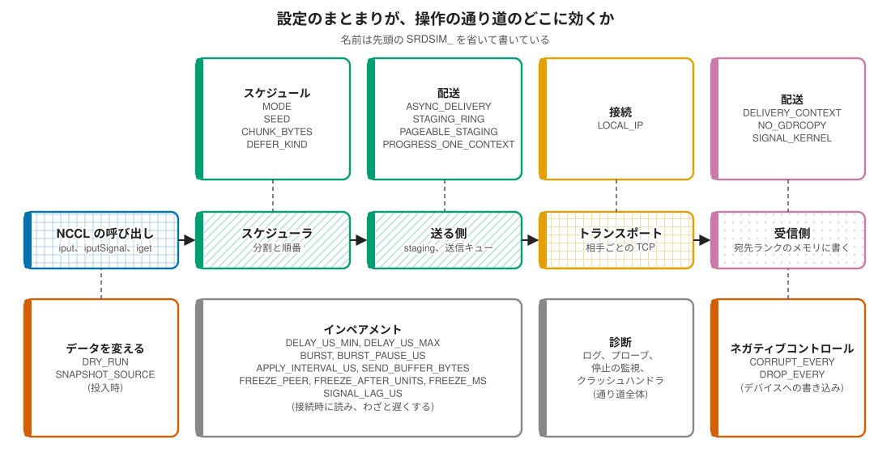
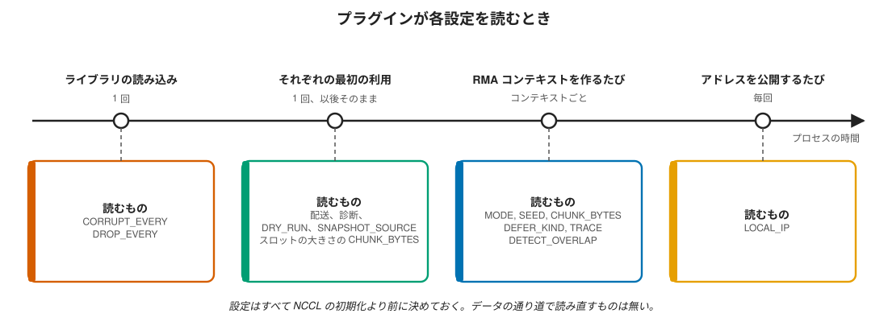

# 設定

[English](configuration.md) | **日本語**

プラグインをビルドし直さずに変えられるものは、すべて `SRDSIM_*` の環境変数である。シミュレータがどの配送の順番を作るか、GPU のメモリへどう書き込むか、何を報告するか、そしてテストが誤りに気づくことを示すためにわざと結果を壊すスイッチがある。設定のまとまりは、それぞれ、NCCL の呼び出しから宛先ランクのメモリまでの操作の通り道の 1 か所に効く。

プラグインは各設定を 4 つの時点のどれかで読む。その時点より後に値を変えても効かない。どれも NCCL の初期化より前に決めておくこと。

`scripts/check_configuration_reference.sh` は、ソースが読む変数と、この文書と英語版の文書の行が食い違うと CI を落とす。比べるのは名前だけで、既定値や効果は比べない。

## 値の読み方

| 型 | 受け付けるもの | それ以外 |
|---|---|---|
| 個数 | 0 より大きい 10 進の整数 | 空、`0`、符号や先頭の空白が付いたもの (`-1`、`+8`)、64 ビットに収まらない値、10 進の整数として読めないもの (`8k`、`0x2000`、`true`、末尾の空白) は既定値になる |
| フラグ | 個数と同じ。正の整数ならオン | 個数と同じなので、`0` と空文字はオフで、`true` と `yes` もオフになる |
| 名前 | その行に書いた名前のどれか | それ以外の値は既定値になる。行に書いた場合は、プラグインがログに残す |
| アドレス | IPv4 のアドレス。そのまま公開する | 確かめない |

プラグインのログは NCCL のロガーに渡り、NCCL は `NCCL_DEBUG=INFO` のときだけそれを表示する。NCCL がプラグインにロガーを渡していないときと、`SRDSIM_LOG_OPS` を設定したときは、stderr にも出る。

## スケジュール

NCCL が RMA コンテキストを作るたびに読む。

| 変数 | 型と既定値 | 効果 |
|---|---|---|
| `SRDSIM_MODE` | 名前、`srd` | 配送のスケジュール。`srd`、`inorder`、`peer-seq`、`reverse-ops`、`signal-last`、`defer-one`、`violate-i1` のどれか ([README](../README.md#delivery-modes) を参照)。知らない名前はログに残し、`srd` を使う |
| `SRDSIM_SEED` | 個数、`1` | スケジュールの乱数の種。`0` は既定値になるので、種に 0 は選べない |
| `SRDSIM_CHUNK_BYTES` | 個数、`8192` | 操作を分けるチャンクの大きさ。1 回だけ読む別の箇所で、ピン留めした staging のスロット 1 つの大きさにも使い、これが `SRDSIM_STAGING_RING` の上限を決める。全ランクで同じ値にすること。受け手のスロットより大きいフレームは、ページング可能なメモリを通してコピーされる。4 MiB を超える値では、受け手は自分の値までの大きさのフレームしか受け付けない。それより大きい値のランクからのフレームはリンクを閉じさせ、そのリンクでまだ送られていない操作は失われる。上限は 64 MiB で、それより大きい値は 64 MiB に下げる |
| `SRDSIM_DEFER_KIND` | 名前、`any` | `defer-one` がどの操作を後回しにするか。種類を問わず最も古いもの (`any`)、または最も古い、シグナルなしの put (`unsignaled`)、シグナル付きの put (`signaled`)、シグナルだけの操作 (`signal-only`)。知らない名前はログに残し、`any` を使う |

## 配送

それぞれを最初に使うときに 1 回読む。ただし `SRDSIM_LOCAL_IP` は、プラグインが自分のアドレスを公開するたびに読む。`SRDSIM_PROGRESS_ONE_CONTEXT` と `SRDSIM_LOCAL_IP` 以外は、`SRDSIM_WITH_CUDA` を付けてビルドしたときにだけある。

| 変数 | 型と既定値 | 効果 |
|---|---|---|
| `SRDSIM_DELIVERY_CONTEXT` | 名前、プラグイン自身の CUDA コンテキスト | デバイスのメモリへのコピーをどこから出すか。既定値と `green` では、デバイスのウィンドウを `ncclMemAlloc` (VMM) で確保しておく必要がある。`primary` はデバイスの primary context を使う。どんな確保の仕方でも受け付けるが、コピーのたびに、そのコンテキストでアプリケーションが行うモジュールの読み込みと解放の後ろで待つ。既定値はこの待ちによるデッドロックを避けている。`green` は SM を最も小さく区切った green context を使う。アプリケーションのカーネルが居座っていても、コピーが割り当て時間を待たない。ただし primary context とロックを共有する。CUDA 12.4 より前でビルドすると、デバイスのウィンドウの登録が失敗する。それ以外の値は既定値になる |
| `SRDSIM_NO_GDRCOPY` | フラグ、オフ | `SRDSIM_WITH_GDRCOPY` を付けてビルドしたときだけ。ウィンドウをピン留めもマップもせず、代わりに CUDA のコピーで配送する。CUDA のコピーは、カーネルがデバイスに居座っている間は終わらない |
| `SRDSIM_ASYNC_DELIVERY` | 名前、`1` | ちょうど `0` のとき、CUDA のコピーをキューに入れずに、出すたびに終わるのを待つ。それ以外の値は既定値になる。キューを使うのは、CUDA のコピー (GDRCopy ではない) とピン留めした staging のときだけ |
| `SRDSIM_STAGING_RING` | 個数、`128` | コピーをキューに入れるとき、1 つのスレッドが同時に使える、ピン留めした staging のスロットの数。最小は 2。ピン留めするメモリがプラグインの上限を超えないように切り詰める。上限は `SRDSIM_CHUNK_BYTES` で決まる |
| `SRDSIM_PAGEABLE_STAGING` | フラグ、オフ | ピン留めしたメモリの代わりにページング可能なホストのメモリを通し、コピーのたびに待つ。再現用のモード |
| `SRDSIM_SIGNAL_KERNEL` | フラグ、オフ | デバイスのメモリへのシグナルを、プラグインが持っている合計値の書き込みではなく、カーネルの起動で反映する |
| `SRDSIM_PROGRESS_ONE_CONTEXT` | フラグ、オフ | コミュニケータのすべてのコンテキストではなく、NCCL が `rmaProgress` に渡したコンテキストだけを進める |
| `SRDSIM_LOCAL_IP` | アドレス、デフォルトルートのアドレス | このランクが、相手からの接続のために公開するアドレス |

## 診断

報告するものを変えるか、手間をかけて何かを確かめる。配送するデータは変えない。`SRDSIM_TRACE` と `SRDSIM_DETECT_OVERLAP` はスケジュールの設定と一緒に読む。`SRDSIM_DETECT_OVERLAP` は、コンテキストをまたぐ確認のために、もう 1 回だけ読む。それ以外は 1 回読む。

| 変数 | 型と既定値 | 効果 |
|---|---|---|
| `SRDSIM_LOG_OPS` | フラグ、オフ | すべての put (シグナルがあればシグナルも) と get を引数付きでログに残す。ログの行をすべて stderr にも出す。停止の監視を動かし、クラッシュハンドラも入れる |
| `SRDSIM_TRACE` | フラグ、オフ | スケジュールがリリースするユニットをすべて stderr に出す |
| `SRDSIM_DETECT_OVERLAP` | 個数、オフ | `1` は、同じ RMA コンテキストの中で、同じ宛先ランクへのまだリリースしていない書き込みと重なる操作を数える。`2` 以上は、RMA コンテキストをまたいでも確かめる。そのときは操作を受け付けるたびに処理中の操作をすべてたどり、ロックが使用中の RMA コンテキストとの重なりは飛ばす。そのため、重なりを見逃すことはあるが、無い重なりを報告することはない |
| `SRDSIM_PROBE_RECORD_BYTES` | 個数、オフ | ペイロードがこの大きさのレコードのちょうど整数個のとき、4 バイトの 0 以上のスタンプを持つレコードとみなす。スタンプを持つレコードと持たないレコードが混ざった操作を報告する。確かめる場所は、送り手がレコードを転送に書くところ、`SRDSIM_SNAPSHOT_SOURCE` がオンのときは操作を投入したところ、CUDA 付きでビルドしたときは受け手がデバイスのウィンドウに書くところ |
| `SRDSIM_PROBE_STAMP_OFFSET` | 個数、`0` | レコードの中のスタンプの位置。スタンプがレコードに収まらないとき、プローブは何も言わずにオフになる |
| `SRDSIM_STALL_MS` | 個数、`10000` | 停止の監視は `SRDSIM_LOG_OPS` を設定したときだけ動く。反映された配置もシグナルも無いまま、この時間 (ミリ秒) がたつと、500 ms ごとに見張っている監視が、各スレッドが最後にどこにいたかを報告する。`0` は既定値になる |
| `SRDSIM_STALL_REPEAT_MS` | 個数、`5000` | 止まっている間に報告を繰り返す間隔 |
| `SRDSIM_BACKTRACE` | フラグ、オフ | クラッシュハンドラを入れる。致命的なシグナルでバックトレースを出してから、シグナルを元の持ち主に返す。`SRDSIM_LOG_OPS` でも入る |
| `SRDSIM_NO_BACKTRACE` | フラグ、オフ | クラッシュハンドラを入れない。`SRDSIM_BACKTRACE` と `SRDSIM_LOG_OPS` より優先する |

## データを変える設定

どれも、わざと、配送するバイトを変えうる。1 回だけ読む。3 つのネガティブコントロール (`SRDSIM_CORRUPT_EVERY`、`SRDSIM_DROP_EVERY`、`SRDSIM_GET_LANDED_EARLY`) は、ライブラリを読み込んだときに読む。

| 変数 | 型と既定値 | 効果 |
|---|---|---|
| `SRDSIM_DRY_RUN` | フラグ、オフ | データを動かさずに、すべての操作をすぐに終わったことにする。呼び出しの並びを見るためのもので、結果は正しくない |
| `SRDSIM_SNAPSHOT_SOURCE` | フラグ、オフ | put を投入したときに、デバイス上の送り元を丸ごとコピーし、そのコピーを送る。リリースする前に送り元が変わったユニットを数える。CUDA なしでビルドすると何もしない。GDRCopy か、同期の配送 (`SRDSIM_ASYNC_DELIVERY=0` か `SRDSIM_PAGEABLE_STAGING`) が要る。そうでないときは無視し、stderr に 1 行出す。遅い |
| `SRDSIM_CORRUPT_EVERY` | 個数、オフ | ネガティブコントロール。このランクが反映するデバイスへの配置の N 個ごとに、真ん中の 1 バイトを反転させる。ホストのウィンドウと、CUDA なしのビルドでは何もしない。有効なときは stderr で知らせる |
| `SRDSIM_DROP_EVERY` | 個数、オフ | ネガティブコントロール。デバイスへの配置の N 個ごとに、書かずに反映したと報告する。範囲と知らせ方は `SRDSIM_CORRUPT_EVERY` と同じ |
| `SRDSIM_GET_LANDED_EARLY` | フラグ、オフ | ネガティブコントロール。get の最後のフレームのデバイスへのコピーを、終わったときではなく積んだときに届いたと数えるので、データが届く前に flush が終わりうる。CUDA なしのビルド、ホストのウィンドウ、GDRCopy、コピーを 1 つずつ待つ配送では何もしない。有効なときは stderr で知らせる |

## インペアメント

どれも、ファブリックをわざと遅く、まとめて届くように、または一部が止まるようにする。データを失わせることはない。liveness (進行性) の不具合をあぶり出すためのものである。コミュニケータは接続するときにこれらを読み、効いているものを stderr に記録する。読み込みは 10 進の整数を受け付け、空や読めない値は既定値になる。上の設定と違い、`0` は `0` のままである。

| 変数 | 型と既定値 | 設定するもの |
|---|---|---|
| `SRDSIM_DELAY_US_MIN`、`SRDSIM_DELAY_US_MAX` | 個数、`0` | リリースするユニットごとの、ランダムな遅れ。最大が最小より小さいときは、最小まで引き上げる |
| `SRDSIM_BURST`、`SRDSIM_BURST_PAUSE_US` | 個数、`0` | この個数のユニットをまとめてリリースし、間を空ける |
| `SRDSIM_APPLY_INTERVAL_US` | 個数、`0` | 受信側が、フレームを反映する前に毎回待つ時間 |
| `SRDSIM_SEND_BUFFER_BYTES` | 個数、`0` | ランクが自分から張る接続のソケットの送信バッファ (`SO_SNDBUF`) の大きさ |
| `SRDSIM_FREEZE_PEER` | 個数、なし | 止める接続の相手。`0` も相手を指す |
| `SRDSIM_FREEZE_AFTER_UNITS`、`SRDSIM_FREEZE_MS` | 個数、`0` | 止める相手にこの個数のユニットをリリースした後、この時間だけ、その相手には何もリリースしない (送る側で、背圧と同じ空きの確かめを通して行う) |
| `SRDSIM_SIGNAL_LAG_US` | 個数、`0` | シグナルごとに足す遅れ |

## libfabric プロバイダ

libfabric プロバイダ (`libsrdsim-fi.so`、[プロバイダの説明](libfabric-provider.ja.md)) が読む。`SRDSIM_FI_WRITE_IN_ORDER` は対応するオプションを設定されるたびに、ほかは endpoint を開くときに読む。プロバイダは `SRDSIM_MODE` (`srd` と `inorder` だけ)、`SRDSIM_SEED`、`SRDSIM_CHUNK_BYTES` も、上と同じ意味で読む。

| 変数 | 型と既定値 | 効果 |
|---|---|---|
| `SRDSIM_FI_WRITE_IN_ORDER` | `0` か `1`、`1` | `1` は、対応する EFA デバイスと同じく `FI_OPT_EFA_WRITE_IN_ORDER_ALIGNED_128_BYTES` を受け付ける。`0` は、対応しないデバイスと同じく `-FI_EOPNOTSUPP` で断る。ほかの値はログに書いて `1` として扱う |
| `SRDSIM_FI_JITTER_US` | 個数、`200` | `srd` のとき、書き込みのチャンクが相手側で適用されるまでに待つ時間の最大値 (マイクロ秒)。各チャンクはこれ以下の乱数の時間だけ待つ。`0` は届いた順にすぐ適用する。`inorder` では使わない |
| `SRDSIM_FI_CQ_DATA_EARLY` | `0` か `1`、`0` | `1` は、CQ データつき書き込みの相手側の完了を最後ではなく最初のチャンクで出す。EFA の保証をわざと破る、それに頼るコードのための陰性対照 |
| `SRDSIM_FI_TRACE` | `0` か `1`、`0` | `1` にすると、libfabric プロバイダが出した操作、適用したフレーム、書いた完了の 1 件ごとに stderr へ 1 行書く |
