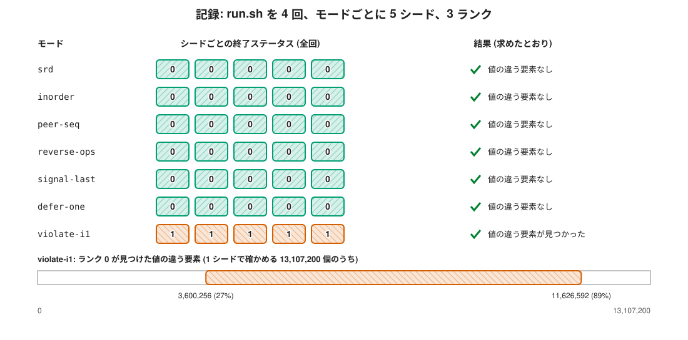

# GPU で確かめる

[English](gpu-validation.md) | **日本語**

この文書は、nccl-srdsim のテストのうち、GPU が要る 1 つについて書く。nccl-srdsim は、GPU のカーネルどうしが送り合うデータを運ぶために NCCL が読み込むプラグインである。AWS SRD のように、順番を守らないが取りこぼしもしない通信路と同じく、シードごとに違う順番でデータを届ける。このテストは、本物の NCCL の下で、NCCL の順番の保証どおりに書いたコードが正しいデータを見ること、そして保証より多くを当てにしたコードなら見つかることを確かめる。

先に言葉をそろえる。NCCL の GIN (GPU-Initiated Networking) のデバイス API を使うと、CUDA のカーネル (GPU で動く関数) が自分でデータを送れる。*put* は、送り手の GPU のメモリの一部を、受け手の GPU のメモリへ写す。*シグナル* (signal) は、受け手のメモリにある 64 ビットのカウンタで、put はデータを書き終えたらそれを増やせる。受け手のカーネルは、このカウンタを見張ってデータが届いたことを知る。*弱い*シグナル (weak signal) が約束するのはそれだけで、自分の put のデータが届いた後で見えるようになるが、他の put については何も約束しない。この約束が不変条件 I1 である ([README](../README.md#delivery-modes) を参照)。*配送モード*は、プラグインが配送の順番を入れ替える決まりで、*シード*はその決まりの中でのプラグインの乱数の選び方を固定する。GPU 自身のタイミングは、実行ごとに変わる。

`tests/gpu/gin_signal_order.cu` は、I1 が守られているときにだけ正しい結果になる小さな CUDA のプログラムで、`tests/gpu/run.sh` はそれを配送モードとシードの組ごとに 1 回ずつ動かす。この 2 つで、ホストのテストでは答えられない 3 つの問いに答える。

1. NCCL はプラグインを読み込み、カーネルの put とシグナルをプラグインに通すか。
2. プラグインは、GPU のメモリとシグナルのカウンタを正しく書くか。
3. I1 を破る配送のとき、カーネルは違うデータを見るか。


7 つの配送モードのうち 6 つは I1 を守るので、どの要素 (送るデータの 1 つ 1 つの値) も期待と違ってはならない。7 つ目の `violate-i1` は、わざと、シグナルをデータより先に届けることがあるので、少なくとも 1 つのシードで、値の違う要素が見つからなければならない。シグナルをデータより先に届けられるのはプラグインだけなので、`violate-i1` で値の違う要素が見つかることは、カーネルの通信がプラグインを通ったことも示す。

| モード | 求める結果 |
|---|---|
| I1 を守るモード (`srd`、`inorder`、`peer-seq`、`reverse-ops`、`signal-last`、`defer-one`) | どのシードでも、値の違う要素が無い |
| `violate-i1` | 少なくとも 1 つのシードで値の違う要素が見つかり、どのシードでもクラッシュも時間切れも起きない |

CI はこのテストをコンパイルする (`gpu-test-compile` のジョブ) が、GPU が無いので、実行は手動で行う。

## テストの仕組み

このテストは、ランクの輪の上でデータを回し、シグナルがチャンクの到着を告げたらすぐに、そのチャンクを確かめる。登場する部品と、それぞれがすることは次のとおりである。

- **ランク**: GPU 0 の上の 1 つのプロセス。`run.sh` が、ランクごとに別の `NCCL_HOSTID` を付けて起動する。これは、NCCL に各ランクを別のマシンとして扱わせ、プロセスの間で直接写さずに、put とシグナルをプラグインに通させるためである。通信がプラグインを通ったことの、このテストでの証拠は、`violate-i1` で値の違う要素が見つかることである。記録した実行はどれも `NCCL_HOSTID` を分けており、1 つの値を共有する形は試していない
- **MPS サーバー**: CUDA の Multi-Process Service。`run.sh` が起動し、ランクのカーネルを、順番待ちではなく同時に GPU の上で動かす
- **ブロック**: ランクのカーネルの 4 つのスレッドブロックの 1 つ。ランク r のブロック b は、ランク r + 1 のブロック b へ送り、最後のランクはランク 0 へ送る。どのブロックも、次のランクへの送り手であり、同時に前のランクからの受け手である
- **スロット**: ブロックが持つ、32 ビットの要素 65,536 個の入れ物。ブロックごとに送信スロットと受信スロットが 1 つずつある
- **チャンク**: 4,096 要素の put 1 つ。スロットは 16 個のチャンクに分けて送り、チャンクごとに別のシグナルのカウンタを使う
- **ラウンド**: スロット 1 つ分のやり取り 1 回。1 つのシードは、既定で 50 ラウンド動く
- **プラグイン**: ランクの間のすべての put とシグナルを、配送モードの順番で運ぶ


1 つのブロックの 1 ラウンドは次のように進む。番号は図と同じである。

1. 送り手のブロックは、送信スロットを埋め、16 個のチャンクに分けて受け手のブロックのスロットへ put する。チャンクごとに、別のシグナルの ID を持つ弱いシグナルが付く。
2. 受け手のブロックは、各チャンクを、そのチャンクのシグナルが見えたときに確かめる (次の節)。
3. 16 個のチャンクをすべて確かめたら、受け手は送り手に弱いシグナルを返し、受信スロットを上書きしてよいと伝える。このシグナルがほかの何に対していつ届くかを、このテストは問わない。そのため、テストが頼る順番は I1 だけになる。
4. 各ブロックは、上流へ自分のシグナルを返した後で flush を呼ぶ。NCCL は flush を、手順 1 で出した put が送り元を読み終えるまで待つものと定めており、これで送信スロットを詰め直せるようになる。それとは別に、ブロックは次のラウンドの初めに、手順 3 の下流の受け手のシグナルを待ってから、送信スロットを詰め直す。

カーネルの 3 つの待ち、つまり空いたスロット、チャンクのシグナル、flush を待つときには、時間の上限がある (既定で 60 秒)。待ちが時間切れになったランクは止まり、カーネルが戻った後に終了ステータス 3 で終わる。

### シグナルが見えたチャンクから確かめる

I1 が破れたことを見つけられるのは、この確かめ方のおかげである。受け手は、チャンクのシグナルが「データがある」と告げたらすぐに読むので、早すぎたシグナルは、データがまだ無いうちに見つかる。受け手のブロックのスレッド 0 は、まだ確かめていないチャンクをチャンク 0 から順に見て回り、シグナルが見えた最初のものを選ぶ。次に、ブロックの全スレッドがそのチャンクを期待する値と比べ、見て回るのをまた最初から始める。シグナルが見えたチャンクが、まだ来ていないシグナルを待つことはない。待つのは、同じくシグナルが見えている、番号の小さいチャンクの確かめだけである。


チャンクはどの順に届いてもよく、I1 を破るのは、自分のデータより先のシグナルだけである。シグナルが見えてからチャンクを読むまでの間 (チャンクの確かめ数回分になることがある) にデータが届いた put は見つからない。そのため `violate-i1` の 1 つのシードで見つかるのは、早すぎたシグナルの一部であり、すべてではない。`violate-i1` に求めるのが、すべてのシードではなく、少なくとも 1 つのシードで値の違う要素が見つかることなのはこのためである。

### 各要素が持つ値

各要素は、ラウンド、送り手のランク、ブロック、要素の位置から計算する。そのため、まだ届いていないデータだけでなく、違うラウンド、ランク、ブロック、位置のチャンクも、値の違う要素として数えられる。受信スロットは初期化しないので、ラウンド 0 では、NCCL がバッファを確保したときの中身が入っている。ランク `s` からのラウンド `r`、ブロック `b` の要素 `i` について、送り手が書き、受け手が期待する値は次のとおりである。

```text
((r + 1) * 0x9E3779B1) ^ (s * 0x85EBCA6B) ^ (b * 0xC2B2AE35) ^ i        (32-bit unsigned)
```

受け手は、確かめているラウンド、上流のランク、自分のブロック、位置からこの値を計算し、違う要素をすべて数える。`r + 1` にすると、ラウンド 0 に 0 を掛けずに済む。


掛ける数はどれも奇数なので、1 つのフィールドの異なる 2 つの値が、掛けた後 (2^32 を法として) 同じになることはない。4 つのフィールドのうち 1 つだけが期待と違う要素は、必ず期待と違う値になる。2 つ以上のフィールドが違う要素は、理屈の上では打ち消し合うことがある。

## 実行スクリプト: tests/gpu/run.sh

`run.sh` は、このテストをすべてのモードで、いくつかのシードで動かし、ランクの終了ステータスから、各モードが求める結果を出したかを決める。1 つのランクが壊れても、実行全体がハングしないようにもする。`tests/gpu/run.sh PLUGIN_SO TEST_BINARY [NRANKS] [SEEDS]` で呼び、既定は 3 ランク、5 シードである。


番号は図と同じである。

1. `run.sh` は、一時ディレクトリに自分の MPS サーバーを起動する。別の MPS デーモンがマシンで既に動いていれば、始めない。
2. モードとシードごとに、全ランクを、ランクごとの `NCCL_HOSTID`、プラグイン (`NCCL_RMA_PLUGIN` と、RMA プラグインを呼ぶ GIN のバックエンドを選ぶ `NCCL_GIN_TYPE=2`)、モード、シードを付けて起動する。どのランクも、`RUN_TIMEOUT` を渡した coreutils の `timeout` コマンドの下で動かす。
3. ランクを待つ。終了 0 か 1 のランクは、普通に終わっている。終了 3 のランクは時間切れで、他のランクも時間切れになりそうなので、10 秒与えてログを書かせてから止める。それ以外で終わったランクは、準備に失敗したか、クラッシュしたか、`RUN_TIMEOUT` で止められており、他のランクは自分の時間の上限までそれを待つだけなので、すぐに止める。`run.sh` は 0.2 秒ごとにランクの番号順で見て回り、最初に気づいたそうした終了が、他のランクの止め方を決める。
4. シードの結果は、その 0 と 1 以外の最初の終了ステータスとする。無ければ、どれかのランクが 1 で終わっていれば 1、そうでなければ 0 である。カーネルの途中で止められたランクは、MPS サーバーにコンテキストを残すことがある。そのため、シードの結果が 3 以上のとき、またはランクが `timeout` かシグナルで止められたとき (終了ステータスが 124 以上) は、`run.sh` は MPS サーバーを起動し直す。
5. モードの全シードが終わると、そのモードが求める結果を出したかを決める。I1 を守るモードは、全シードの結果が 0 なら合格である。`violate-i1` は、全シードの結果が 0 か 1 で、1 つ以上が 1 なら合格である。`run.sh` は、`PASS` か `FAIL` で終わるそのモードの行と、シードごとに、ランク 0 が書いていればその結果の行を出す。この行は、値の違う要素を `wrong elements` と書く。モードが不合格のときは、失敗した各シードについて、全ランクのログの最後の 5 行も出す (`violate-i1` が、どのシードでも値の違う要素が見つからなかったことだけで不合格になったときは出さない)。すべてのモードが合格なら 0 で終わる。全ランクのログを含む作業ディレクトリは、失敗したときだけ残し、合格した後は消す。

判定のもとになる、テストのプログラムの終了ステータスの値:

| 値 | 意味 |
|---|---|
| 0 | 値の違う要素は無かった |
| 1 | 値の違う要素があった |
| 2 | 引数が正しくない、60 秒以内にランク 0 の unique id のファイルが現れない、または CUDA か NCCL の呼び出し (終わりに NCCL を終了させる呼び出しを含む) が失敗した |
| 3 | カーネルの待ち (空いたスロット、チャンクのシグナル、flush) が時間切れになった。操作がまだ残り、他のランクがもういないかもしれないので、NCCL を終了させずに終わる |

`run.sh` は次の環境変数を読む:

| 変数 | 既定値 | 効果 |
|---|---|---|
| `RUN_TIMEOUT` | `180` | ランクが `timeout` に止められるまでの秒数。戻ってこない put やシグナルの呼び出しも、これで終わる |
| `WAIT_TIMEOUT` | `60` | カーネルが 1 つのシグナルか 1 回の flush を待つ秒数。過ぎると、ランクは終了ステータス 3 であきらめる |
| `ROUNDS` | `50` | シードごとのラウンドの数 |
| `MODES` | 7 つすべて | 動かす配送モード。空白で区切る |

## 必要なもの

- NVIDIA の GPU 1 枚。記録した実行は compute capability 12.0 で、他の世代では試していない
- `nvidia-cuda-mps-control` を含むユーティリティ付きの NVIDIA ドライバ。MPS デーモンが既に動いていないこと
- `nvcc` を `PATH` に通した CUDA 13 のツールキット (`/usr/local/cuda/bin` に入る)。下の NCCL の wheel は CUDA 13 向けである
- CMake 3.20 以上、C++17 のコンパイラ、git、`venv` 付きの Python 3 (Ubuntu では `python3-venv` のパッケージ)

## 実行

`tests/gpu/recipe.sh` は、バージョンをすべて `versions.env` から読む。固定した NCCL の wheel (2.32.6) を入れ、プラグインのビルドに要るヘッダのために固定した NCCL のソースを取得してコミットを確かめ、プラグインをビルドし、テストを wheel の NCCL に対してコンパイルし、3 ランク、5 シードで全モードを動かす。どの手順が失敗しても、そこで止まる。ビルドの後の実行は約 75 秒かかる。

```bash
export PATH=/usr/local/cuda/bin:$PATH
git clone https://github.com/littlemex/nccl-srdsim.git
cd nccl-srdsim
./tests/gpu/recipe.sh 3 5
```

最後のコマンドは、モードごとに `PASS` か `FAIL` で終わる行と、シードごとのランク 0 の値の違う要素の数を出し、すべてのモードが求める結果を出したときに 0 で終わる。

## 記録した結果

`run.sh` の 4 回の実行のどれでも、7 つのモードすべてが求める結果を出した。



測ったのは、コミット `ff11cc9` のプラグインとテストである。その後に変わったのは `src/` のコメントとホストのテストだけで、`tests/gpu/` は変わっていない。マシンは `g7.2xlarge` (NVIDIA RTX PRO 4500 Blackwell Server Edition が 1 枚、compute capability 12.0、ドライバ 595.112.07) で、Deep Learning Base OSS Nvidia Driver GPU AMI (Ubuntu 24.04) 20261117 の上で、上の wheel の NCCL 2.32.6 と、イメージに入っている CUDA 13 のツールキットを使った。「実行」の節のコマンドは 4 回実行した。1 回は上に書いたとおりそのまま、残りの 3 回は同じビルドで同じ `tests/gpu/run.sh PLUGIN TEST 3 5` のコマンドを使った。1 回の実行は、3 ランク、モードごとに 5 シード、ブロックごとに 65,536 要素を 16 チャンクで送る 50 ラウンドで、約 75 秒かかった。

| モード | シードごとの終了ステータス (全回) | ランク 0 が報告した値の違う要素 |
|---|---|---|
| `srd`、`inorder`、`peer-seq`、`reverse-ops`、`signal-last`、`defer-one` | 0 0 0 0 0 | すべての回のすべてのシードで 0 |
| `violate-i1` | 1 1 1 1 1 | 4 回のシード 1〜5 を通して、1 シードあたり 3,157,632〜11,900,672 |

各ランクは 1 シードで 13,107,200 個 (65,536 個 × 4 ブロック × 50 ラウンド) の要素を確かめるので、`violate-i1` では、ランク 0 が確かめた要素の 24%〜91% が期待と違う値だった。

時間切れの経路も、同じコミットで 1 回動かした。`MODES=srd ROUNDS=20000 WAIT_TIMEOUT=5` で 2 シードとし、シード 1 の開始から 20 秒後に、ランク 1 を `SIGSTOP` で止めた。ランク 0 と 2 は、4 つのブロックが 5 秒で時間切れになったことをログに残した。最初に時間切れになったのは、それぞれ 20,000 ラウンド中のラウンド番号 5,231 と 5,237 で、空いたスロットを待っていたものと、チャンクのシグナルを待っていたものだった。シード 1 は 3 と報告され、MPS サーバーは起動し直され、シード 2 は 0 で終わり、`run.sh` はログを残して 1 で終わった。
